# NEXUS — Cinematic 3D Portfolio · Master Prompt + Design Handoff

> **One prompt to build the whole site.** Hand this file (plus the `reference/` folder beside it) to the implementing engineer or AI agent. Everything below was measured from the reference footage at **10 frames per second**. I opened every decoded frame, built a transition strip for each of the 43 transitions, and ran pixel analysis for colour, scale and motion. Times are reference-video seconds. Colours marked *measured* were sampled from frames; colours marked *est.* are visual estimates where anti-aliasing made a sample unreliable.

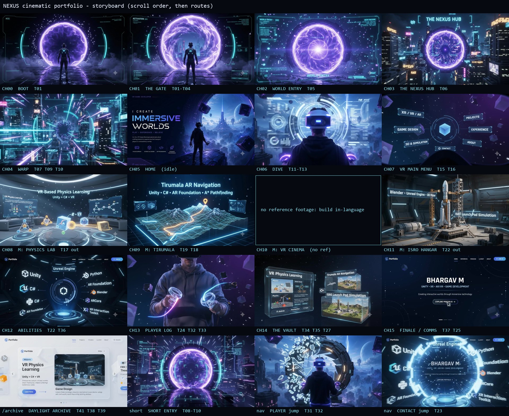

---

## 0 · The prompt (read this first)

You are building **NEXUS**, the scroll-driven, real-time 3D portfolio of **Bhargav M** (Unity · XR · AR/VR · game development). The visual target is the set of AI-generated reference films in `Ref_Videos/`, decomposed in this document into **16 chapters, 43 transitions and 15 background layers**. Build it as **real, detailed, real-time 3D**: layered geometry, PBR materials, emissive lighting, reflections, volumetric atmosphere and post-processing. Then **prove** it matches by placing your screenshots beside the reference key frames (§13).

**Hard rules**

1. **Fidelity bar.** The owner has rejected two shortcuts before: low-detail procedural look-alikes ("like a small kid made") and scrubbing the reference clips as video ("cheap clips"). **Never** embed, scrub or frame-sequence the reference MP4s. Every frame is rendered by the engine. Pre-rendered posters are allowed only as loading and Lite-mode stand-ins, and only when they are rendered *from your own 3D scenes*.
2. **Truthful content.** All copy comes from `src/data/nexus.ts` and `src/config/site.ts`, never from the footage. The AI footage contains garbled or invented text that must **not** be copied: `NEXX FSCURE`, the `GSAP` label, `Crud / Ura`, `Gyber Design`, `Prolyhunt`, `Game Castes`, `Wave Corts`, `LET MORE`, `DNIMEA`, `100FT - ANT`, `28-ARD / AR`, `DEPENCES / POSCESS / LLIENCT`, `LOG IN`. Respect the `verified` switches. While `verified.physicsVR` is false, the footage's "VR-Based Physics Learning" is shown as **"Game-Based Physics Learning"**. While `verified.xrInteractionToolkit` is false, there is **no XR Interaction Toolkit node**.
3. **No watermark.** Every reference frame carries a ✦ sparkle near the bottom-right, the AI generator's mark. Do not reproduce it.
4. **Stack.** Next.js **16.3** App Router. *Read `node_modules/next/dist/docs/` before writing code, because this Next.js has breaking changes; see `AGENTS.md`.* Also React 19.2, `@react-three/fiber` 9, `@react-three/drei` 10, `@react-three/postprocessing` 3 / `postprocessing` 6, `three` r185, GSAP 3.15 + ScrollTrigger, Lenis 1.3, Tailwind 4, and Firebase for the contact form. Reuse what already exists where it meets the bar: `src/lib/director.ts`, `rig.ts`, `store.ts`, `sound.ts`, `focusTrap.ts`, `src/config/quality.ts`, and the `src/components/three/hero/*` and `missions/*` worlds. Rebuild anything that doesn't meet the bar.
5. **Performance and access are features.** Hold 60 fps on the high tier and 45 fps on the medium tier. Provide reduced-motion and Lite modes, a skip-intro control at all times, full keyboard reach, and no flashing above 3 per second (§11, §12).

**Work in phases.** Each phase ends with a side-by-side screenshot comparison against the listed key frames, fixing what differs before moving on:

| Phase | Scope | Compare against |
|---|---|---|
| 0 | Read the Next 16 docs and inventory the existing code. Decide reuse vs rebuild per world and write the decision down. | n/a |
| 1 | Engine: the chapter director (Lenis → ScrollTrigger → `rig`), the dual-render-target **TransitionPass** (§8.0), quality tiers, Lite mode and the semantic DOM skeleton with all content | n/a |
| 2 | CH00–CH04 intro, plus the Short Entry | KF01–KF21 |
| 3 | CH05 Home, CH06 Dive, CH07 VR menu | KF22–KF27, KF37–KF39 |
| 4 | CH08–CH11 missions | KF28–KF33, KF40, KF57–KF60 |
| 5 | CH12 Abilities, CH13 Player Log, CH14 Vault, CH15 Finale + Comms | KF34–KF36, KF41, KF55, KF61–KF71 |
| 6 | `/archive` daylight glass route | KF42–KF54 |
| 7 | QA: compare script, performance, accessibility, polish | all |

---

## 1 · Reference set

| ID | File (in `Ref_Videos/`) | Specs | What it is |
|---|---|---|---|
| **C1** | `download/Part_1_of_2__Cinematic_20261001052145.mp4` | 10.0 s · 1280×720 · 24 fps | **Primary.** The Gate: idle portal → HUD boot → activation → vortex → white-out |
| **C2** | `download (1)/Part_2_of_2__Cinematic_20261001052201.mp4` | 10.0 s · 1280×720 · 24 fps | **Primary.** World Entry → threshold → The Nexus Hub → second portal → hyperspace |
| **VR** | `Player_entering_VR_portal_animation_20261001051526.mp4` | 8.0 s · 1920×1080 · 24 fps | Compact 8 s version of the whole entry. Used as the **Short Entry** |
| **P1–P6** | `portfolio_1.mp4` … `portfolio_6.mp4` (copies also in `Docs/Game/analysis/assets/`) | 10.0 s each · 1280×720 · 24 fps | Six AI variations of the site *after* entry. Each starts from the same Home hero and explores a different route |

> **Archive note.** During this analysis the VR clip and portfolio_1–4 were removed from `Ref_Videos/`. All nine had already been decoded, so every reference image below is complete. Copies of portfolio_1–6 remain in `Docs/Game/analysis/assets/`. No other copy of the VR clip was found, so its contact sheets, key frames and strips are now its only record.

**Reference images** (all under `reference/`):

- `storyboard.jpg` shows the whole site on one page.
- `keyframes/KFxx_<video>_<t>s_<slug>.jpg`: 71 full-resolution stills at the decisive moments.
- `transitions/Txx_<slug>_<video>_<t0>-<t1>s.jpg`: 43 strips. Each shows 8 evenly spaced frames; read them left→right, top→bottom.
- `contact-sheets/<video>_<t0>-<t1>s.jpg`: **every** 10 fps frame of every video (44 sheets, 20 frames each), labelled with time and a motion value. Motion is the mean absolute luma change per 0.1 s on a 0–255 scale: about 1 means still, 10–20 a camera move, 30 or more a whip or cut.
- `data/motion-metrics.json` (per-frame luma and motion), `data/palette.json` (k-means palette per key frame plus accent medians per video), `data/index.json`.
- Rebuild everything with `python Docs/NEXUS-Cinematic/tools/build_reference.py` (needs ffmpeg, Pillow and numpy).

---

## 2 · Experience architecture

### 2.1 Narrative

**Entry** (the avatar crosses into the NEXUS) → **Home** (the player stands at the edge of the world) → **Dive** (into the headset, which is the portfolio's operating system) → **Missions** (one 3D world per project) → **Abilities** → **Player Log** (who the player is) → **Vault** (all work) → **Finale / Comms**. The Gate avatar (sci-fi suit, C1) and the Home player (hoodie with headset and controllers, P-series) are the same person in-world and out-of-world. Keep the body proportions and the headset silhouette identical.

### 2.2 Routes and modes

| Mode | When | What plays |
|---|---|---|
| **Full Entry** | First visit, desktop or tablet, high or medium tier | CH00 → CH01 → CH02 → CH03 → CH04 → CH05 … |
| **Short Entry** | Return visits within 7 days (`localStorage` flag, wrapped in try/catch), all phones, low tier, or "REPLAY ENTRY" | CH00 → **SE** (VR clip, T08–T10, 320 vh) → CH05 … |
| **Skip** | The `SKIP INTRO` button (first focusable element), `Esc`, or a deep link (`/#missions`…) | Teleport under cover (§8.0) straight to the target chapter |
| **Lite** | `prefers-reduced-motion`, no WebGL2, context lost twice, or "Lite" toggle | Same DOM content with static posters rendered from the scenes and 200 ms crossfades. No pinning, no scrub |
| **`/archive`** | Nav "ARCHIVE" | Daylight glass route (§6), fast and conventional, also linked from Lite |

### 2.3 Scroll engine

- **One** fixed full-viewport `<Canvas>` sits behind the DOM, and **one** Lenis instance (`lerp 0.1`, `wheelMultiplier 1`, `touchMultiplier 1.4`) is driven from `gsap.ticker`.
- Each chapter is a pinned `<section>` with its own GSAP timeline, scrubbed by ScrollTrigger (`scrub: true`; Lenis already smooths). Timelines write **plain numbers** into the mutable `rig` (`src/lib/rig.ts`). The render loop reads `rig`. **No React state changes per frame.**
- **Scroll length rule:** `scrollVh = refSeconds × VH_PER_REF_SECOND`, with `VH_PER_REF_SECOND = 40` (pointer) and `30` (touch). Holds are added explicitly. Scrubbing at 40 vh/s reproduces the reference pacing exactly.
- **Autoplay.** The "ENTER THE NEXUS" button (and an idle auto-advance after 6 s on CH01 p=0) tweens Lenis at 40 vh/s with `linear` easing until CH05. Any wheel, touch or key input cancels it.
- **Idle never freezes.** When scrolling stops mid-chapter, the scrubbed values hold but idle loops continue: plasma, fog, particles, cubes, window flicker and the player's breathing.
- **Velocity coupling.** `rig.scrollVel = lenis.velocity` (clamped ±60) feeds the streak length (BG06), the HUD skew (BG07), the chromatic offset and the particle stretch.
- Only the current chapter's world and one either side are mounted. The next world's assets preload one chapter ahead. Dispose geometries and textures two chapters back.

### 2.4 Chapter map (scroll order)

| # | Chapter | Scroll | Reference | Transitions | Background layers |
|---|---|---|---|---|---|
| CH00 | **Boot** (loader) | time-based | C1 2.3–4.0 | T01 | BG01 · BG07 |
| CH01 | **The Gate** | 400 vh | C1 0.0–9.9 | T01 T02 T03 T04 | BG01 BG02 BG07 BG14 |
| CH02 | **World Entry** | 125 vh | C2 0.0–3.1 | T05 | BG03 BG07 BG14 |
| CH03 | **The Nexus Hub** | 120 vh (hold 0–0.4) | C2 3.1–4.5 | T06 | BG05 BG14 |
| CH04 | **Warp** | 200 vh | C2 4.5–9.9 (×0.6) + VR 6.0–7.9 | T07 T09 T10 | BG05 BG06 BG07 |
| SE | **Short Entry** (alt. CH01–CH04) | 320 vh | VR 0.0–7.9 | T08 T09 T10 | BG05 BG06 BG07 BG14 |
| CH05 | **Home** | 60 vh hold | P1–P6 at 0.0 | (copy intro) | BG01 BG02 BG04 |
| CH06 | **Dive** | 100 vh | P1 1.0–3.4, P2 1.4–3.8 | T11 T12 T13 | BG04 |
| CH07 | **VR Main Menu** | 120 vh (hold 0–0.67) | P1/P2 3.1–4.4 | T15 · click T16 | BG01 BG04 BG08 |
| CH08 | **Mission: Game-Based Physics Learning** (lab) | 160 vh | P1 3.9–4.7, P5 3.5–4.7 | T27 · out T17 | BG01 |
| CH09 | **Mission: Tirumala AR Navigation** (terrain) | 200 vh | P1 5.0–5.9, P2 4.8–6.4, P5 5.0–7.0 | T19 T18 T27 · out T21 | BG11 |
| CH10 | **Mission: VR Cinema Platform** (cinema) | 160 vh | *no reference*; build in-language | T27 · out T20 | BG01 BG08 |
| CH11 | **Mission: ISRO Launch Pad Simulation** (hangar) | 160 vh | P1 6.0–6.9, P2 6.6–7.7, P5 7.3–8.2 | T27 · out T22 | BG12 |
| CH12 | **Abilities** (tech constellation) | 160 vh | P1 7.3–8.1, P5 8.5–9.4 | T22 T36 · out T24 | BG09 BG01 |
| CH13 | **Player Log** (about + experience) | 220 vh | P6 2.3–4.4 | T24 T32 T33 · out T34 | BG04 BG05 BG08 |
| CH14 | **The Vault** (all work + side quests) | 240 vh | P6 4.4–7.4, P5 1.6–2.7 | T34 T35 T27 · click T28 · out T36 | BG01 BG05 |
| CH15 | **Finale / Comms** | 120 vh + flow | P6 7.4–8.9, P1 8.8–9.9 | T36 T37 T25 | BG01 BG04 BG10 BG15 |

When `verified.isroMission` is false, or the cinema mission is filtered out, the chain stays continuous: CH09 → CH11 uses **T20** and the pin lengths recompute. Supporting 1–8 missions: mission *i → i+1* uses `MISSION_EXITS = [T17, T21, T20, T29]` cyclically, and the last mission always exits with **T22**.

### 2.5 Nav-jump transitions (time-based, then teleport under cover)

| Trigger | Signature transition | Lands on |
|---|---|---|
| Nav **MISSIONS** from Home | T11 + T13 (fast, 1.2 s) | CH07 menu |
| Nav **PLAYER LOG** from Home | T11 + T31 + T32 (P6 1.1–3.1) | CH13 |
| Nav **ARCHIVE** hover/focus on Home | T26 iris preview inside the portal frame, reversible | stays |
| Nav **ARCHIVE** click | from Home T41 (+T42 on arrival); elsewhere T38 | `/archive` |
| Nav **COMMS** pill (anywhere) | T23 portal burst | CH15 contact |
| Menu label click (CH07) | T16 labels explode | label's chapter (§5 CH07) |
| Finale CTA **EXPLORE PORTFOLIO** | T14 droste visor dive | CH07 menu |
| `←` / `→` on a mission chapter | T20 (prev/next) | adjacent mission |
| Deep link `/#<chapter>` | T21 hard push from black | that chapter |
| "REPLAY ENTRY" (footer, Home) | Short Entry from SE p=0 | CH05 |

---

## 3 · Design tokens

Add these to `src/styles/tokens.css` (`:root`) and reference tokens, not raw values. Sizes were measured at 1280 px width and converted to `clamp()`.

### 3.1 Colour: dark world

| Token | Value | Source | Usage |
|---|---|---|---|
| `--void-0` | `#02030A` | KF01, 38 % of frame (measured) | Gate sky, deepest black |
| `--void-1` | `#030B18` | KF36 corner (measured) | Finale edges, page base |
| `--navy-1` | `#08162F` | KF36 centre (measured) | Finale radial centre |
| `--navy-2` | `#0C1026` | KF01 (measured) | Gate mid-tones |
| `--fog-shadow` / `--fog-lit` | `#111930` / `#6E6A9A` | KF01 fog (measured / est.) | Fog body / portal-lit fog edge |
| `--floor` | `#080A16` | KF01 floor (measured) | Wet platform base |
| `--nebula-1/2/3` | `#181C40` / `#0D122A` / `#2A345F` | KF26 (measured) | VR menu, Vault |
| `--city-1/2/3` | `#121823` / `#212D45` / `#304064` | KF10 (measured) | Nexus Hub night city |
| `--warp-1…4` | `#142338` `#213A5C` `#2F557E` `#4778A1` | KF12 (measured) | Hyperspace corridor |
| `--hero-sky-1…6` | `#01081C` `#0D1537` `#1D2A5B` `#304C96` `#4A72BC` `#8AADDE` | KF22 (measured) | Home vista, dark → bright |

### 3.2 Colour: energy and light

| Token | Value | Source | Usage |
|---|---|---|---|
| `--plasma-deep` | `#302973` | C1 membrane body (measured) | Portal membrane base |
| `--plasma-mid` | `#6059AC` → `#8364CE` | KF01 / C1 median (measured) | Membrane mid-tone, filaments |
| `--plasma-hot` | `#BDA6EF` | C1 5.0 s hot (measured) | Rim and filament highlights |
| `--plasma-rim` | `#C5B0ED` | KF01 (measured) | Rim band |
| `--core-white` | `#F7E6FA` | C1 / VR (measured) | Portal core and flare |
| `--whiteout-ramp` | `#925DC8 → #B47BDC → #CD99E8 → #E2B6F0 → #F3D4F6 → #FCF4FB` | KF07 (measured) | White-out radial gradient, edge → centre |
| `--hud-cyan` | `#61E2EB` | C1 hot (measured) | HUD lines and arcs, Gate |
| `--hud-cyan-2` | `#78D8EF` | C2 hot (measured) | HUD titles, World Entry |
| `--hud-cyan-dim` | `#4FADC5` | C2 median (measured) | Secondary HUD lines, data text |
| `--hud-glow` | `rgba(97,226,235,.45)` | derived | `drop-shadow`, bloom-layer emissive |
| `--streak-cyan` / `--streak-violet` | `#70CFDE` / `#BDAEE9` | C2 hot (measured) | Hyperspace streaks and ribbons |
| `--neon-pink` / `--neon-pink-hot` | `#E374BC` / `#FF5FD2` | C2 median / est. | City neon, P6 light trails |
| `--sign-amber` | `#E1A565` | VR (measured) | City signage |
| `--route-amber` / `--route-glow` | `#DE8528` / `#FFB45A` | P5 (measured / est.) | Terrain route, pins, ring-segment lights (T31) |
| `--menu-label` | `#70A3CF` | P1 menu hot (measured) | VR menu chip text and stroke |

### 3.3 Colour: UI on dark

| Token | Value | Source | Usage |
|---|---|---|---|
| `--text-hi` | `#FAFCFF` | "BHARGAV M" (measured) | Identity, hero names |
| `--text-hero` | `#F6F8FB` | "WORLDS" (measured) | Large display, white |
| `--text-sub` | `#A5BFD3` | Finale subtitle (measured) | Role line, sub-heads |
| `--text-body` | `#D5DCEA` | est. | Body on dark |
| `--text-muted` | `#AEB6CC` | est. | Hero paragraph, captions (≥ 4.5:1 on `--void-1`) |
| `--grad-immersive` | `linear-gradient(90deg,#59B0F0 0%,#4E84EB 50%,#6853EE 100%)` | "IMMERSIVE" (measured) | Display gradient fill |
| `--tagline-violet` | `#8A7CF0` | est. | "PLAY • EXPERIENCE • BELIEVE", eyebrow |
| `--nav-pill` | `linear-gradient(90deg,#496FE0,#469EDA)` | KF36 (measured) | Primary nav pill |
| `--nav-active` | `#4B8BF5` | est. | Nav underline 2 px |
| `--cta-fill` / `--cta-fill-hover` | `#1B2634` / `#556475` | KF36 crops (measured) | Outlined CTA rest / hover |
| `--cta-stroke` | `linear-gradient(90deg,rgba(214,222,236,.75),#6E62E8)` | est. | CTA 1.5 px border |

### 3.4 Colour: daylight archive

| Token | Value | Source |
|---|---|---|
| `--day-1/2/3` | `#DEE1E6` / `#CDD3DD` / `#B7BCC7` | KF43 (measured) |
| `--day-ink` | `#1F2848` | KF43 (measured) |
| `--day-accent` | `#5070CC` | P3 "Learn More" (measured) |
| `--day-warm` | `#E0965D` | KF43 icon (measured) |
| `--day-sky` | `#A9C8F2` | KF50, est. |

### 3.5 Glass

| Token | Dark glass | Light glass |
|---|---|---|
| fill | `rgba(16,24,44,.55)` | `rgba(255,255,255,.45)` |
| backdrop | `blur(18px) saturate(140%)` | `blur(24px) saturate(160%)` |
| border | `1px rgba(150,200,240,.28)` plus a 1 px top highlight `rgba(255,255,255,.12)` | `1px rgba(255,255,255,.7)` |
| radius | card `14px` · chip `10px` · pill `999px` | card `18px` · tile `16px` |
| shadow | `0 20px 60px rgba(0,0,0,.45)` | `0 10px 40px rgba(31,40,72,.12)` |
| focus/hover rim | `0 0 0 1px rgba(97,226,235,.6), 0 12px 40px rgba(97,226,235,.25)` | `0 0 0 1px rgba(80,112,204,.5), 0 12px 32px rgba(80,112,204,.2)` |

In 3D, glass uses drei `MeshTransmissionMaterial` (`thickness .6`, `roughness .05`, `chromaticAberration .03`, `anisotropicBlur .1`, `samples 6` high / `3` medium). Low tier falls back to `MeshPhysicalMaterial` (`transmission .9`).

### 3.6 Typography

| Token | Font | Measured | `clamp()` | Use |
|---|---|---|---|---|
| `--type-display` | **Custom SVG wordmark** (the footage's crossed-stroke W in "WORLDS" is bespoke). Fallback: Orbitron 700 | IMMERSIVE cap ≈58 px @1280 (~80 px font) | `clamp(44px,6.25vw,112px)` / lh .95 / tracking .01em | "IMMERSIVE" (gradient), "WORLDS" (`--text-hero`) |
| `--type-identity` | Oxanium 800 (already loaded) | cap 48 px (~64 px) | `clamp(40px,5vw,92px)` / tracking .03em | "BHARGAV M" |
| `--type-wide` | Chakra Petch 500 | cap 20 px (~27 px) | `clamp(16px,2.1vw,36px)` / tracking .42em | "I CREATE" |
| `--type-role` | Chakra Petch 600 | ~22 px | `clamp(14px,1.72vw,30px)` / tracking .04em | "UNITY • XR • AR/VR • GAME DEVELOPMENT" |
| `--type-hud-title` | Chakra Petch 600 | ~19 px | `clamp(13px,1.5vw,26px)` / tracking .08em / upper | "ACTIVATION [02]", "WORLD ENTRY - [02]" |
| `--type-hud-display` | Chakra Petch 700 | ~32 px | `clamp(18px,2.5vw,44px)` / tracking .06em | Bottom "WORLD ENTRY" |
| `--type-hub` | Chakra Petch 700 | ~36 px | `clamp(20px,2.8vw,52px)` / tracking .12em | "[ THE NEXUS HUB ]" |
| `--type-body-l` | Inter 400 | ~19 px | `clamp(15px,1.5vw,24px)` | Finale line |
| `--type-body` | Inter 400 | ~14 px / lh 1.55 | `clamp(14px,1.1vw,18px)`, max 42ch | Hero paragraph, card body |
| `--type-label` | Chakra Petch 600 | ~13 px | `clamp(11px,1vw,15px)` / tracking .06em / upper | Nav, chips, menu labels |
| `--type-cta` | Chakra Petch 700 | ~16 px | `clamp(13px,1.25vw,18px)` / tracking .04em / upper | CTA pills |
| `--type-micro` | Share Tech Mono (or JetBrains Mono) | 8–9 px | `clamp(9px,.7vw,12px)` | HUD data, icon captions |
| `--type-card-title` | Sora 600 (glass-card titles; footage uses a rounded geometric sans) | ~22 px | `clamp(16px,1.7vw,28px)` | Mission/vitrine titles |

Before locking the display font, overlay it on **KF22** at 1280×720. If Orbitron's W/R/S shapes differ visibly, draw the SVG wordmark.

### 3.7 Spacing, layout and z-layers

- 4 px base. Section gutter `--gutter: clamp(20px,4.06vw,72px)` (the hero copy sits 52 px from the left at 1280). HUD inset `--hud-inset: clamp(12px,2.35vw,40px)` (30 px at 1280). Nav height `clamp(56px,6.25vw,96px)`.
- Z-order from back to front: `canvas (0)` → `chapter DOM copy (10)` → `HUD frame (20)` → `nav (30)` → `transition cover (40)` → `case-file overlay / dialogs (50)` → `skip / a11y live region (60)`.
- Breakpoints: `sm < 768` (phone), `md 768–1023` (tablet), `lg 1024–1439`, `xl ≥ 1440`.

---

## 4 · Background layers (persistent and scroll-reactive)

| ID | Layer | Look (from footage) | Scroll binding | Idle loop | Chapters |
|---|---|---|---|---|---|
| **BG01** | Star field | Three depths: far 1 px dots at 40 % (1,500), mid 2 px (400), near bokeh discs 8–18 px blurred at 30 % (60) | Parallax 0.05× / 0.15× / 0.40× of camera travel. Near bokeh streaks with `scrollVel` | Twinkle (random 0.6–1.0 opacity, 2–5 s) | CH00 CH01 CH05 CH07 CH08 CH12 CH14 CH15 |
| **BG02** | Volumetric fog banks | Low lavender-grey banks left and right of the platform, lit by the portal (KF01). Body `--fog-shadow`, rim `--fog-lit` | Fog pulls toward the camera at 1.2× dolly speed (the gap opens as you push in) | Lateral drift 0.5–1.5 % vw/s, noise churn | CH01 CH05 |
| **BG03** | Bokeh particle rain | Cyan and pink-violet discs 2–24 px; near ones large and blurred, far ones small and sharp (KF08) | Speed × (1 + `scrollVel`/40); streaks lengthen while scrolling | Slow fall 2–6 % vh/s with sideways sway | CH02 |
| **BG04** | Floating cubes | Home: dark glossy cubes with violet emissive edges, 5–12 % vw (KF22). Menu/Finale: translucent blue-violet glass (KF26, KF36). Archive: frosted white glass | Parallax by depth. On T11 they drift outward | Rotate 6–15 °/s, bob ±2 % vh over 5–9 s | CH05 CH06 CH07 CH13 CH15 `/archive` |
| **BG05** | Neon megacity | Window-grid skyscrapers, amber/pink/cyan signs, holo billboards, elevated highway with arch gates, traffic trails, drones (KF10, KF21) | Scroll = camera position along the avenue rail | Window flicker, traffic flow, sign buzz, drone paths | CH03 CH04 SE CH13 CH14 |
| **BG06** | Hyperspace streaks | Straight lines from a vanishing point, 50/50 `--streak-cyan`/`--streak-violet`; later sinusoidal ribbons (KF12, KF14) | **Length = base + k·`scrollVel`**: scrolling faster makes the warp faster. Density follows chapter progress | Minimum speed 15 % | CH04 SE · transition covers |
| **BG07** | HUD frame (screen-anchored SVG) | Chamfered cyan frame, corner brackets, modules (§7.1) | Scale 1→1.03 and chromatic split 0→2 px with `|scrollVel|`. Modules boot and shut down on progress | Numerals tick, bars shimmer, cursor blink | CH00–CH04 SE |
| **BG08** | Nebula | Violet-navy base `--nebula-*` with soft purple cloud (`#3A2A6E` at 30 %) on the right (KF26) | Slow parallax 0.1× | Cloud drift 0.3 %/s | CH07 CH10 CH13 |
| **BG09** | Diagonal light streaks + pad rings | Thin cyan-white diagonals at ~30°, 10–20 % opacity. Teleporter pad with concentric rings (KF34) | Streaks slide with scroll | Ring pulse outward every 2.4 s | CH12 |
| **BG10** | HUD arcs | Thin 1 px arcs at top-right (centre ≈ 90 %/7 %, r ≈ 13 % & 16 % vw) and bottom-left (KF36), `#2A3A55` | Mouse parallax ±8 px | Rotate 0.5 °/s | CH15 |
| **BG11** | Grid floor | Cyan grid `#2C6E9E` at 50 % on navy, horizon fade (KF30) | Grid scrolls toward the camera with dolly | 0.2 cell/s drift | CH09 |
| **BG12** | Hangar interior | Cyan strip lights, light shafts, dust motes, floor teleport rings (KF32, KF60) | Dolly-linked | Strip-light flicker, motes drift | CH11 |
| **BG13** | Daylight sky | `--day-1 → --day-2` gradient, soft clouds, frosted cubes, blurred city (KF50, KF43) | Parallax 0.1–0.3× | Cloud drift | `/archive` |
| **BG14** | Plasma membrane | §7.2 shader | Swirl, window amount and rim boost are scrubbed | Turbulence (speed .15), rim flicker, 0.8 Hz emissive pulse | CH01 CH02 CH03 SE |
| **BG15** | Side progress rails | Vertical dotted rails at x 2.7 % / 97.3 %, y 37–60 %, with one 6 px dot (KF36) | Dot position = page progress | none | CH05, CH15 |

---

## 5 · Chapters (layout, 3D content, copy, scroll beats)

Progress `p` runs 0→1 across each pinned chapter. "t" is reference time. Unless stated otherwise, the mapping is linear: `t = t0 + p·(t1 − t0)`.

### CH00 · Boot (loader)
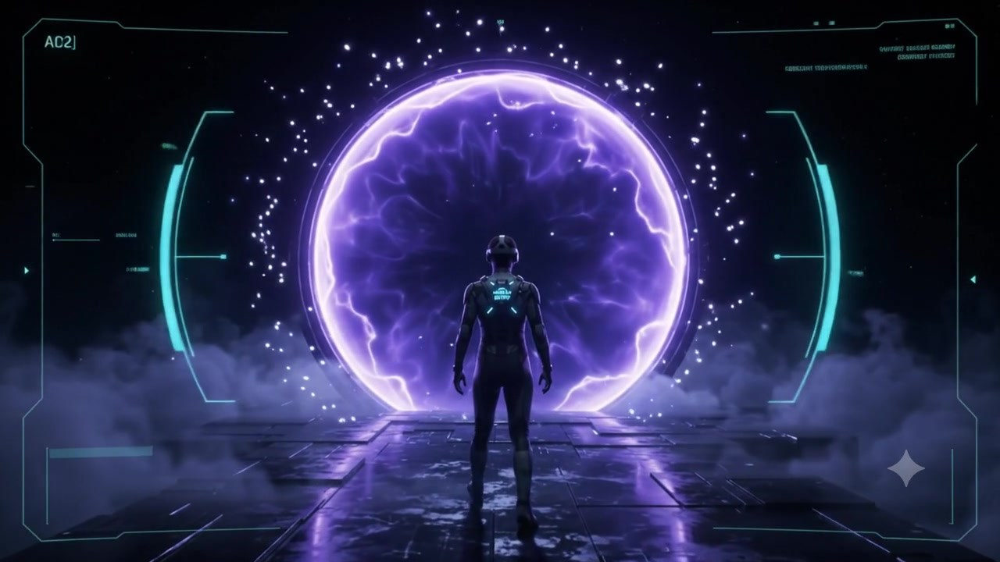
- Black `--void-0` screen with the Gate's static poster (rendered from your CH01 scene at p=0) faded to 35 %. The HUD frame boots with **T01** (time-based) while assets load.
- The TL module reads `ACTIVATION [01]`. The BR counter shows **real load progress** `000 → 100`, and the BL bars represent geometry, textures and audio.
- Minimum 1.2 s. On ready, the HUD dims to 0 over 0.4 s and CH01 p=0 cross-fades in. After 8 s without ready, offer `ENTER LITE`.

### CH01 · The Gate — C1 0.0–9.9 → 400 vh
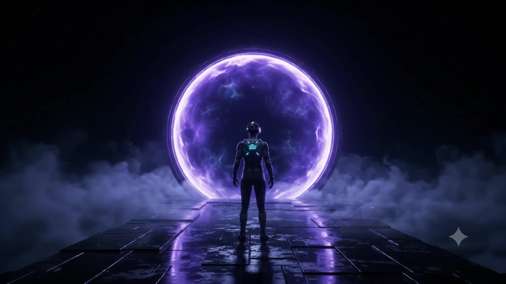 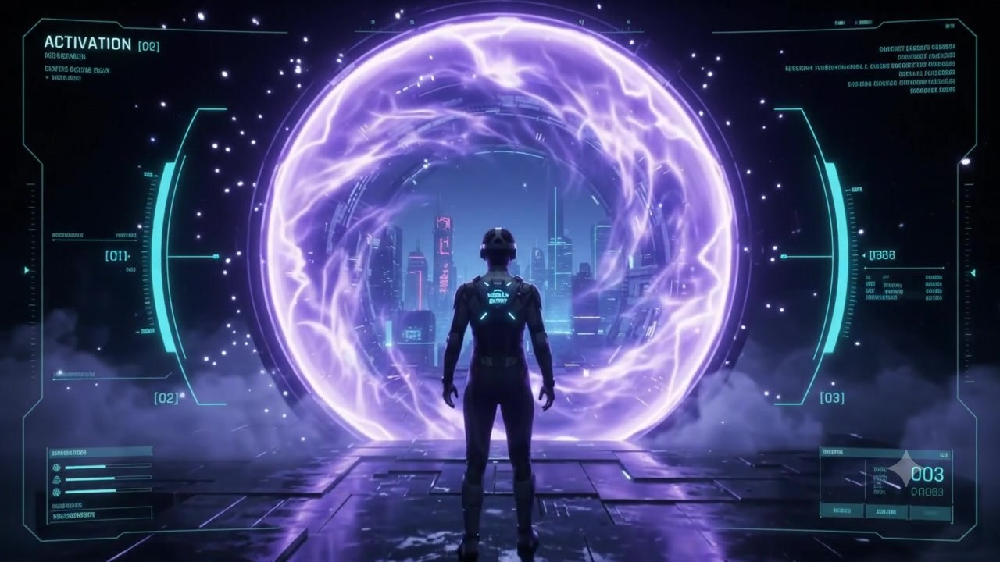 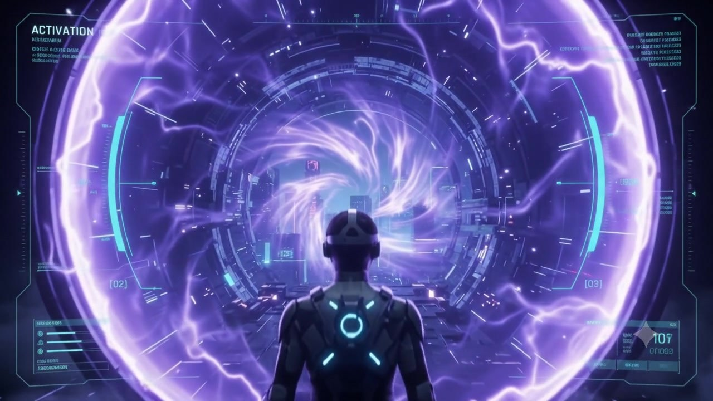 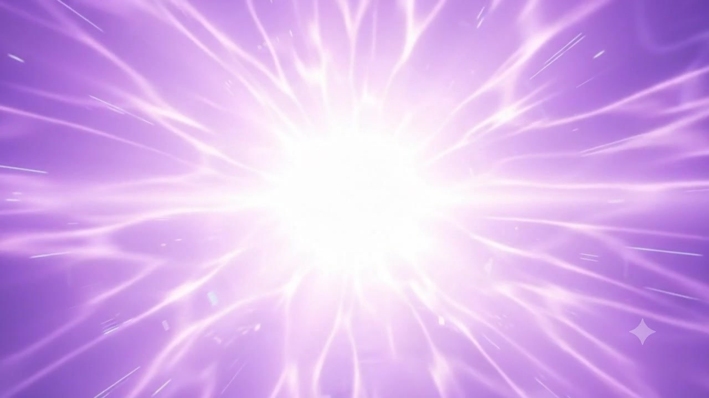

**Composition at p=0 (KF01):** symmetrical, camera on the portal axis.

- **Portal:** outer rim Ø **32 % vw**, centred at **(50 %, 44 %)**, with a thin dark outer ring at Ø 33.6 %. The rim's bottom meets the platform end at y ≈ 70 %.
- **Avatar:** centred, back to camera, head top at 43 % vh and feet at 84 % vh (**41 % vh** tall). Slim graphite sci-fi suit, helmet/VR visor, emissive cyan back panel and shoulder-blade strips.
- **Platform:** a raised walkway of large dark tiles (≈2 m) with 1 px cyan seams, narrowing toward the portal. Wet patches (low roughness) carry a long violet reflection.
- **Atmosphere:** fog banks fill y 49–86 % on both sides. The sky is near-black with sparse stars.
- **DOM:** no hero text in the footage. Add only a small TL identity block in HUD style (`PLAYER // BHARGAV M` and `CLASS // UNITY · XR DEVELOPER`), a bottom-centre `SCROLL TO ACTIVATE` cue, `ENTER THE NEXUS` (autoplay) and `SKIP INTRO`. These fade out by p=0.25.

**Camera dolly (measured).** The portal's share of the viewport width follows

`w(t) = 0.31 + 0.53·(t/7.8)³` for t ∈ [0, 7.8] (GSAP `power2.in`).

Measured points: 31 % → 40 % (3.9 s) → 54 % (6.0 s) → 69 % (7.2 s) → 84 % (7.8 s). With a fixed FOV (35° vertical), set the camera distance `d(t) = d0 · 0.31 / w(t)`. Then from 7.8 to 8.8 s, `d → 0` with `power3.in`; the camera rises 0.15 m to pass over the avatar's head and crosses the membrane at 8.8 s.

| p | t | Beat |
|---|---|---|
| 0.00–0.23 | 0.0–2.3 | **Idle.** Plasma idles, fog drifts, slow dolly starts |
| 0.23–0.40 | 2.3–4.0 | **T01** HUD boot and particle swarm |
| 0.34–0.46 | 3.4–4.6 | **T02** membrane becomes a window onto the neon city |
| 0.45–0.80 | 4.5–7.9 | **T03** vortex spin-up and push. The avatar's back emblem pulses at 1.2 Hz |
| 0.79–1.00 | 7.8–9.9 | **T04** pass the avatar → core flare → white-out. Mean luma 116 → 208/255 (measured) |

### CH02 · World Entry — C2 0.0–3.1 → 125 vh
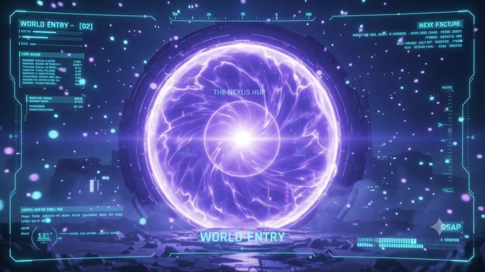 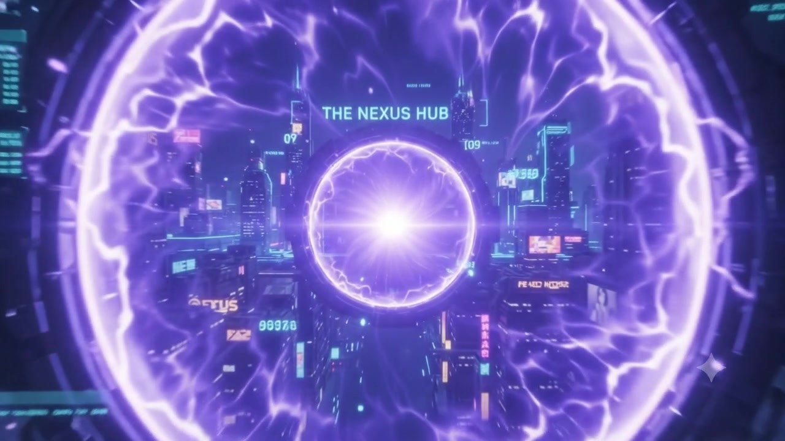

- **Bridge from white:** p 0–0.12 cross-fades `--whiteout-ramp` into the scene. The HUD "reboots" with a 3-frame glitch (slice offsets ±6 px).
- **Scene:** a head-on violet plasma portal inside a **dark segmented mechanical torus** (thicker than the Gate's). The plasma spirals into a white core with a horizontal anamorphic flare. A thin inner ring sits at 40 % of the portal Ø, and "**THE NEXUS HUB**" floats inside above the core. Foreground: dark rocky ground with ruined towers in fog, left and right. Bokeh rain (**BG03**) throughout.
- **HUD** (§7.1, World Entry variant):
  - TL `WORLD ENTRY - [02]` with 3 bars and a `LINK STATUS` table.
  - TR right-aligned data, `NEXUS SECURE` (corrected from the footage's garble).
  - BL circular gauge `131°`.
  - BR segmented loader (cyan blocks filling left→right).
  - Top-centre ruler with ticks every 10 units, labels 20/40/…/100.
  - Bottom-centre **`WORLD ENTRY`** display title.
- **Dolly (measured):** portal width 38.5 % at 1.2 s → 99.4 % at 3.0 s, following `w = 0.385 + 0.615·((t−1.2)/1.8)³` (`power2.in`).

| p | t | Beat |
|---|---|---|
| 0.00–0.32 | 0.0–1.0 | Bridge, HUD reboot, idle swirl |
| 0.32–0.65 | 1.0–2.0 | "THE NEXUS HUB" fades in (opacity, y +8 px→0); dolly starts at 1.2 s |
| 0.65–0.90 | 2.0–2.8 | HUD frame scales 1→1.12 and its edges fade; push accelerates |
| 0.90–1.00 | 2.8–3.1 | **T05** threshold: radial blur 0→0.35, luma peak (131), then city (76) |

### CH03 · The Nexus Hub — C2 3.1–4.5 → 120 vh
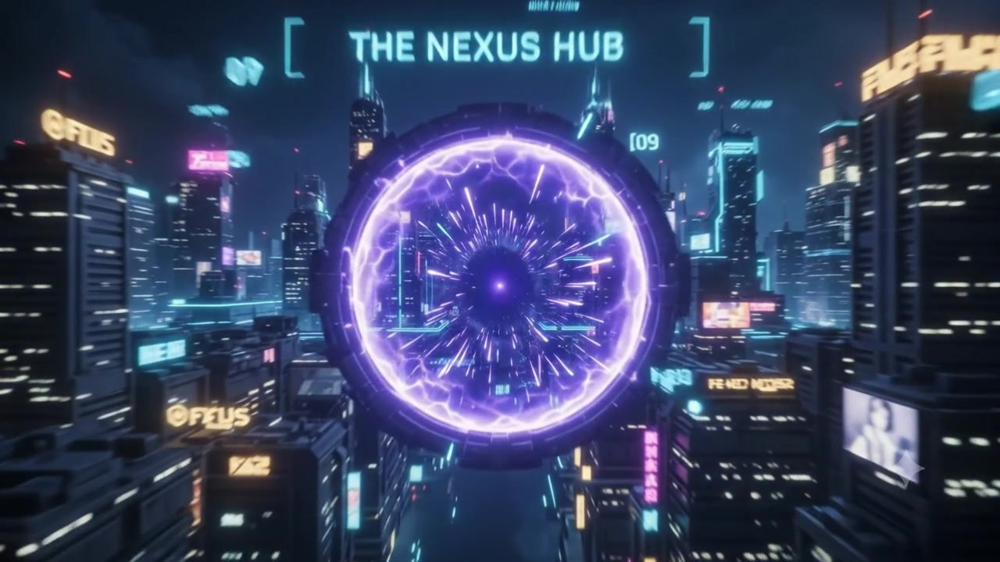 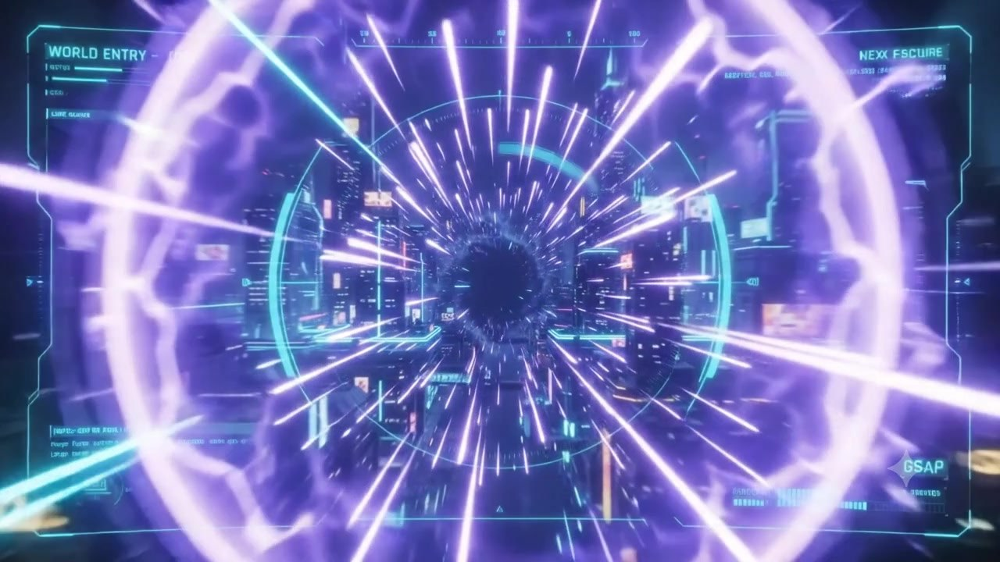

- **Scene:** a night cyberpunk megacity (**BG05**). The camera glides at rooftop height down a central avenue. A **second portal** (violet plasma in a dark mechanical ring) hovers mid-air over the avenue, at 35 % vw on arrival. Its interior shows radial hyperspace streaks.
- **Title:** "**[ THE NEXUS HUB ]**" at top centre (y ≈ 8 %) in `--hud-cyan-2`. Small floating tags `[09` / `09` beside towers.
- p 0–0.40 is a **hold**: camera speed drops to 25 % while **T06** plays its title reveal. Over p 0.40–1.0 the camera approaches, streaks erupt from the portal (count 30→120), and it enters at p=1.

### CH04 · Warp — C2 4.5–9.9 (compressed ×0.6) + VR 6.0–7.9 → 200 vh
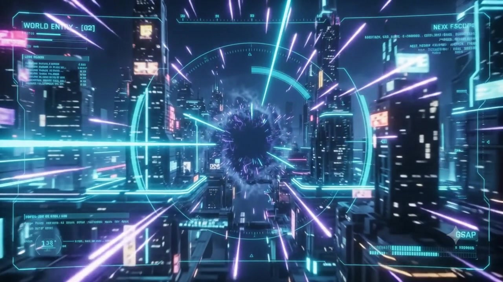 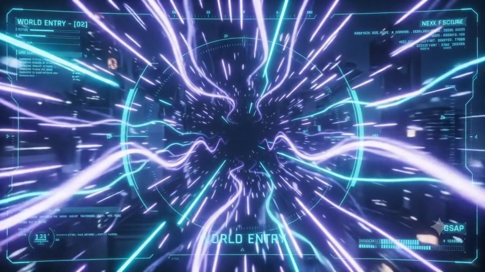 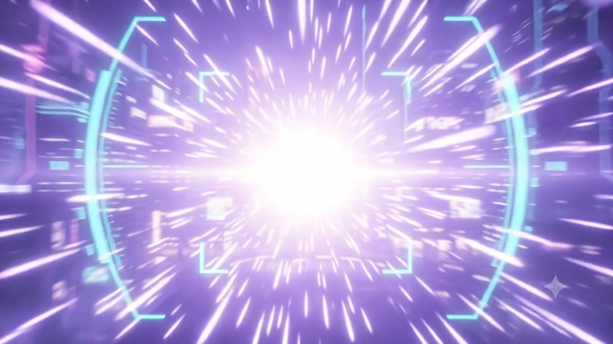

| p | Reference | Beat |
|---|---|---|
| 0.00–0.62 | C2 4.5–9.9 | **T07**: corridor → cyan laser rails → wormhole lightning → sinusoidal ribbons. HUD frame back at 70 % |
| 0.62–0.80 | VR 6.0–6.8 | **T09** tail: white-violet streak tunnel; brackets expand past the edges |
| 0.80–1.00 | VR 6.8–7.9 | **T10**: bloom recedes, streaks shorten and resolve into **the Home vista's city lights**. A short glide over the violet fantasy city (spire, clouds) ends with the camera decelerating (`power3.out`) into the Home framing behind the player on the cliff |

### SE · Short Entry — VR 0.0–7.9 → 320 vh (or 8 s autoplay)
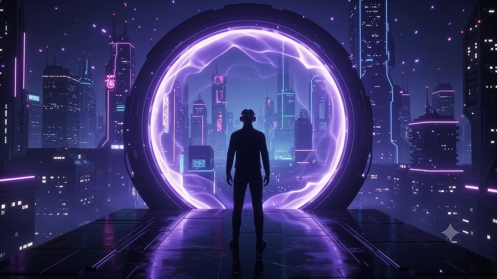 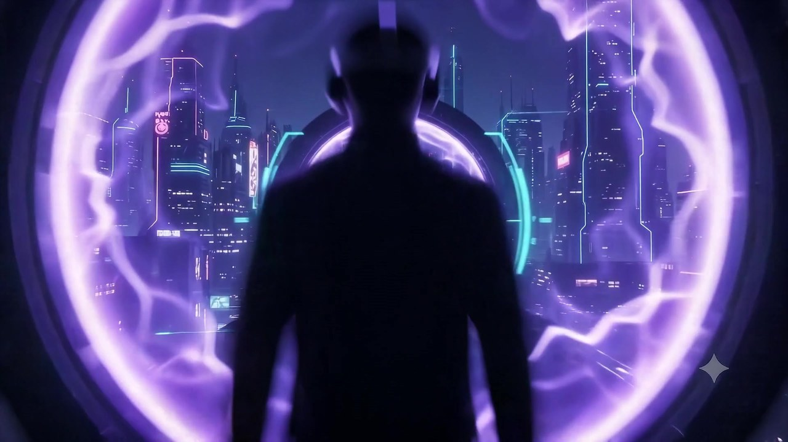 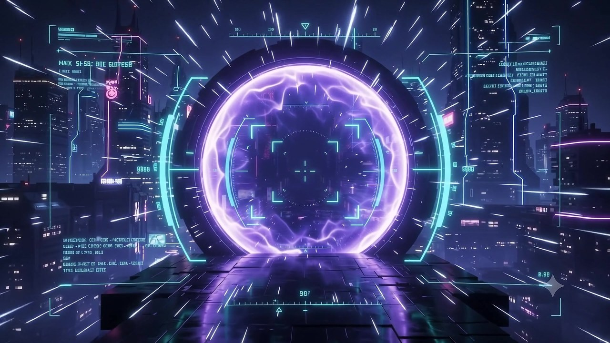 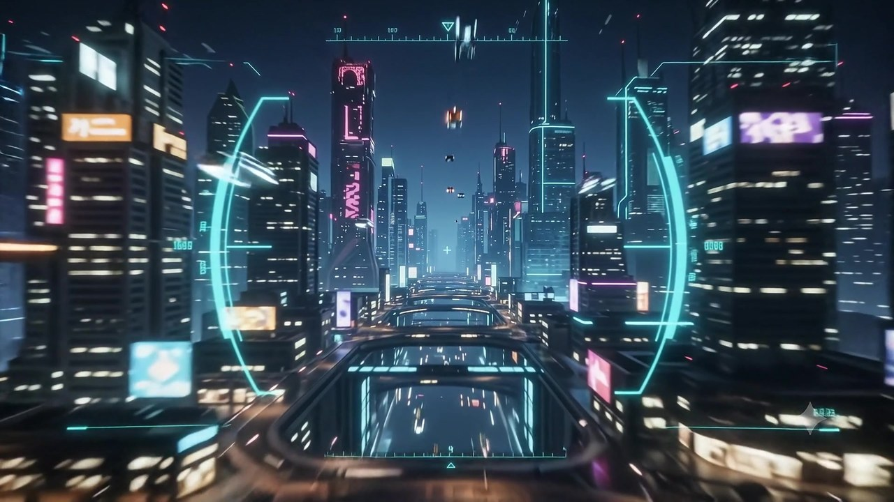

- **Rooftop of the violet megacity at night.** A free-standing portal (thick dark segmented ring, outer Ø ≈ 25 % vw at p=0) holds a translucent membrane that shows the city behind it. A blue-cyan glow sits at its base. The silhouetted player (jacket, headset) stands centred. The floor is glossy with a violet streak.
- Beats: **T08** (p 0.15–0.27), first-person reticle HUD with streaks (p 0.27–0.50), **T09** (p 0.50–0.76), **T10** (p 0.76–1.0, resolving into Home as in CH04).
- **Dolly after the cut (measured):** portal 28.7 % (2.1 s) → 76.6 % (5.7 s), steeper than C1 (`power3.in`).

### CH05 · Home — 60 vh hold
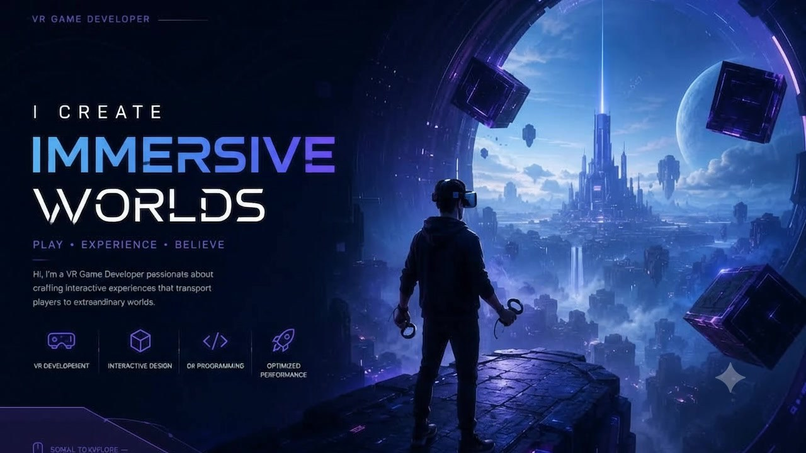

**Layout at 1280×720 (KF22):**

- **Copy column** x 4.1–42 % vw, with a vertical rhythm of:
  - eyebrow `VR GAME DEVELOPER ——` at y 4 % (`--type-label`, `--tagline-violet`, 80 px rule after it)
  - `I CREATE` baseline at 26 % (`--type-wide`, white)
  - **IMMERSIVE** at 30–38 % (`--grad-immersive`)
  - **WORLDS** at 41–49 % (`--text-hero`)
  - `PLAY • EXPERIENCE • BELIEVE` at 54 % (`--type-label` 15 px, `--tagline-violet`, tracking .2em)
  - paragraph at 60–67 % (`--type-body`, `--text-muted`, 3 lines, ~300 px)
  - four icon features at 73–83 %
  - `SCROLL TO EXPLORE` mouse cue at the bottom-left, inside a chamfered panel line.
- **Copy text:** the eyebrow and paragraph come from `hero` in `nexus.ts`. Show the "VR" wording only when it is true. The four features are VR DEVELOPMENT (headset), INTERACTIVE DESIGN (cube), XR PROGRAMMING (`</>`) and OPTIMIZED PERFORMANCE (rocket). Each has a 30 px violet-blue gradient line icon and a 9–10 px caps label, in 115 px columns split by 1 px dividers.
- **Scene** (right 60 %):
  - The player (hoodie, headset, two controllers) stands **back to camera** at x 56 %, 58 % vh tall, feet near the bottom, on a cliff ledge of dark tiled stone.
  - A **huge circular frame** has its centre near (78 %, 46 %) and a radius ≈ 42 % vh, so only its left arc and top are visible. It frames a violet fantasy city at dusk: a central spire with a vertical light beam, floating islands and towers, a waterfall, a big moon at the top right and soft clouds.
  - Dark glossy cubes with violet edges float around it (BG04): about (61 %, 20 %) 9 % vw, (93 %, 22 %) 10 %, (92 %, 69 %) 13 %, plus small ones.
- **Copy intro on arrival** (designed, not in the footage; keep subtle, 0.9 s total):
  - eyebrow rule draws in
  - `I CREATE` tracking .8em → .42em
  - IMMERSIVE: `clip-path` reveal left→right while a 20 % lighter gradient band sweeps across
  - WORLDS reveals 0.08 s later
  - remaining lines fade up 12 px, staggered 0.06 s
- **Idle:** spire beam pulses (1.6 s), clouds drift, cubes rotate, player breathes (idle clip), controllers glow softly, mouse parallax ±1.5 % per depth layer.
- **Nav appears here** (§7.6) and stays for CH05–CH15.

### CH06 · Dive — P1 1.0–3.4 → 100 vh
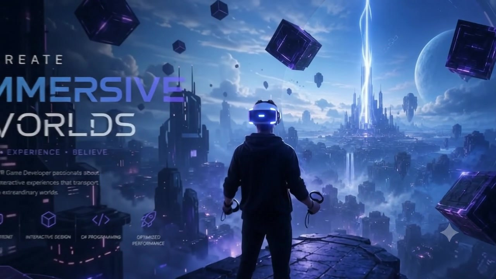 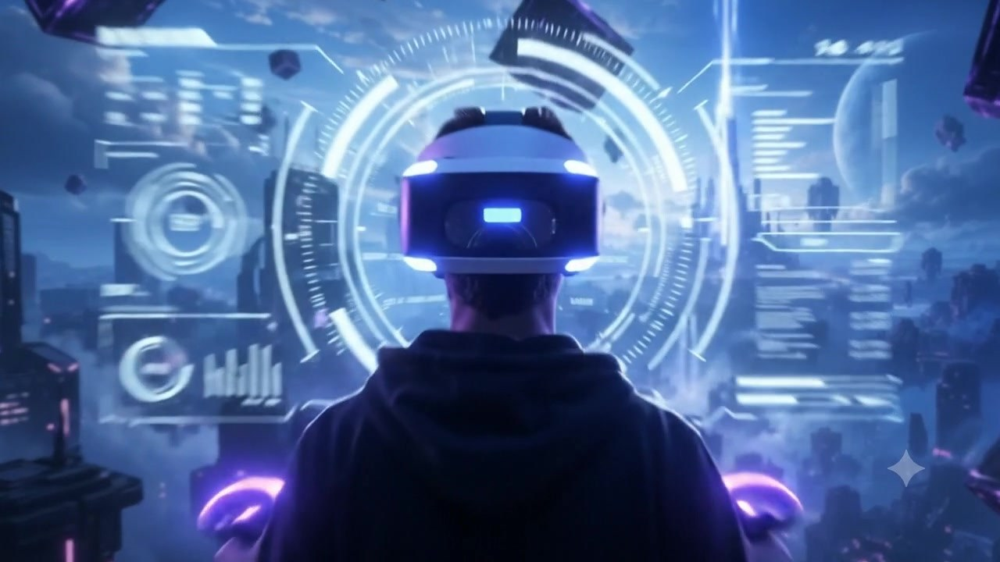 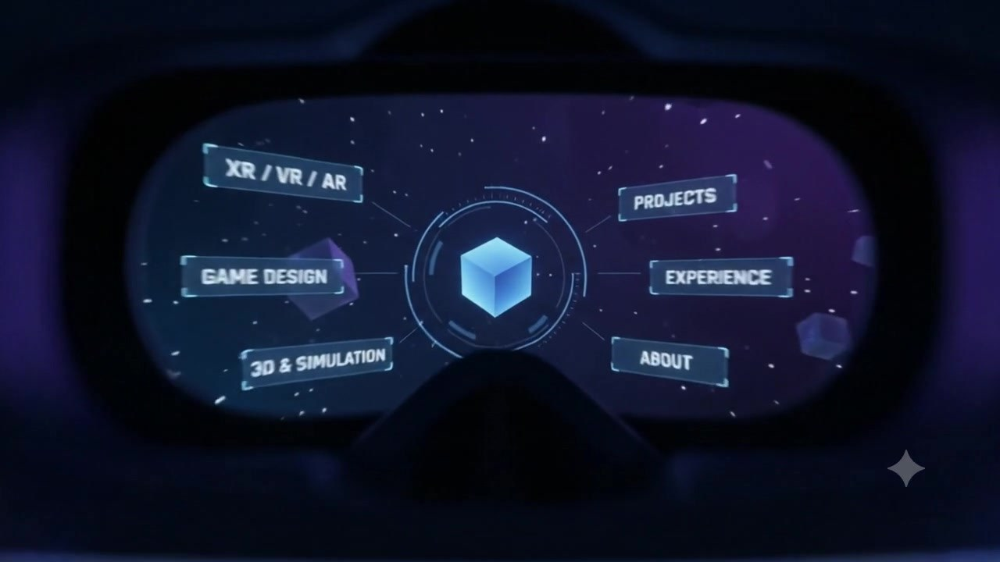

| p | t | Beat |
|---|---|---|
| 0.00–0.42 | 1.0–2.0 | **T11**: push in on the player; copy slides left and fades; headset LEDs ignite at 1.5–1.6 s |
| 0.42–0.75 | 2.0–2.8 | **T12**: holo rings and data panels materialise around the head; camera reaches the back of the headset, whose visor screen now shows the menu |
| 0.71–1.00 | 2.7–3.4 | **T13**: dive through the visor → goggle mask → menu fills the screen |

### CH07 · VR Main Menu — P1 3.1–4.0 → 120 vh (hold p 0–0.67)
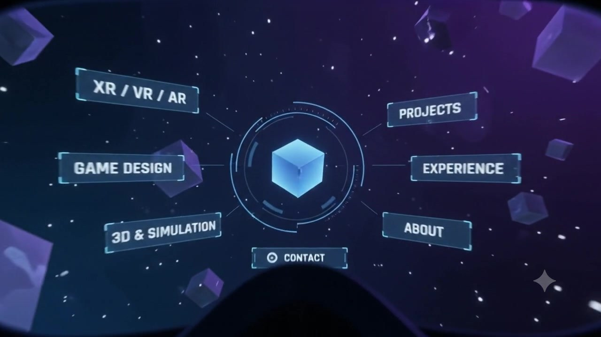 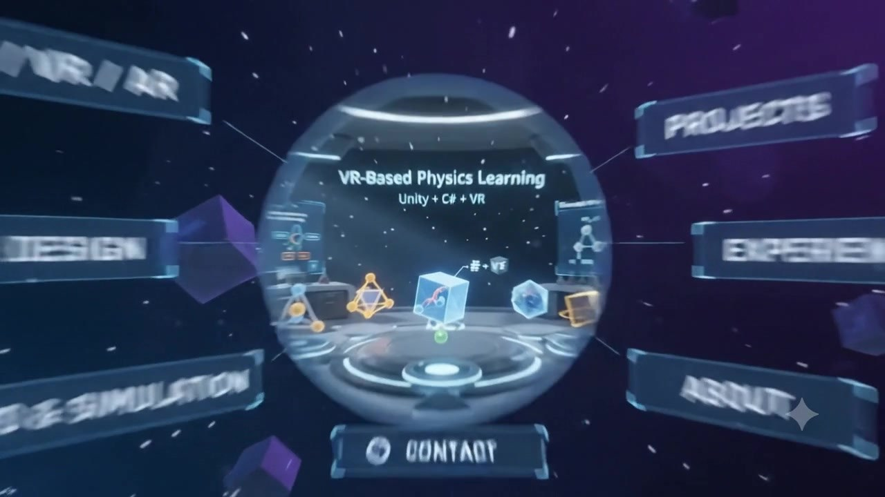

- **Centre:** a glowing blue isometric **cube** (glass with emissive edges, ≈ 8.6 % vw, centred at (49.5 %, 48.6 %)) inside an inner ring (Ø ≈ 20 % vw) and an outer arc set (Ø ≈ 23 % vw, three dashed segments), with tick marks. They counter-rotate at 8 °/s and 12 °/s.
- **Seven glass chips**, placed at these measured centres in KF26:
  - left: `XR / VR / AR` (23 %, 27 %), `GAME DESIGN` (20 %, 50 %), `3D & SIMULATION` (27 %, 69 %)
  - right: `PROJECTS` (72 %, 33 %), `EXPERIENCE` (77 %, 50 %), `ABOUT` (71 %, 68 %)
  - bottom: `⊙ CONTACT` (50 %, 77 %), smaller
  - Chip text: Chakra Petch 700, cap ≈ 18 px at 1280 → `clamp(14px,1.9vw,30px)`, colour `#E6ECF5`.
  - Chip body: dark glass with a 1 px `--menu-label` stroke at 35 % and bright `--hud-cyan` **L-corner accents** (8 px arms) at the top-left and bottom-right corners. Each chip is tilted ±6–8° in 3D toward the centre.
  - Thin connector lines run from the ring to each chip.
- The goggle mask's dark nose-bridge silhouette lingers at the bottom centre (y 80–100 %) until T15 starts.
- **Background:** BG08 nebula, translucent violet cubes and a star field.
- **Interaction:** chips are `<button>`s. Hover or focus lifts a chip 4 px, brightens its stroke and lights its connector, and the cube turns toward it (yaw ±25°). Arrow keys cycle the selection and Enter activates it.
- **Destinations (via T16):** PROJECTS → CH08 · EXPERIENCE / ABOUT → CH13 · XR / VR / AR, GAME DESIGN, 3D & SIMULATION → CH14 filtered by that tag · CONTACT → CH15.
- **Scroll path:** p 0.67–1.0 plays **T15** (cube → orb lens → the first mission).

### CH08–CH11 · Mission chapters (shared structure)

Each mission chapter plays these beats in order:

1. **Enter** (the previous chapter's exit transition).
2. **Establish** (p 0–0.35): a slow push-in (+12 % scale) on the diorama. The title and a stack line float in 3D: `title` in `--type-card-title` 600 white with a soft glow, and the stack line built from `system[]` joined with ` • `.
3. **Feature beat** (p 0.2–0.55): the mission-specific animation.
4. **Case-file state** (p 0.5–0.85): glass panels materialise with **T27** using that mission's reference layout. They show:
   - `code` · `tag` chip, `title`, `summary`, `system[]` chips and `hud[]` lines (mono)
   - core mechanic / challenge / result as short paragraphs
   - `source` and `live` links, plus **OPEN CASE FILE**, which runs **T29** into a full accessible dialog with all fields. Closing it plays **T30**.
5. **Exit** (p 0.85–1.0).

#### CH08 · Game-Based Physics Learning (lab) — 160 vh
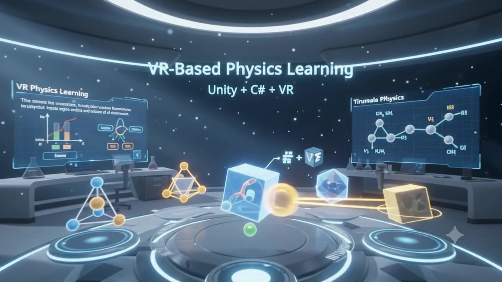 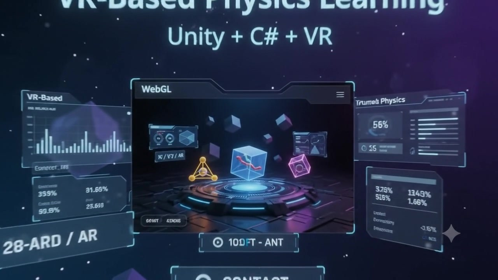

- **Diorama (KF28):**
  - a circular sci-fi lab with a white ceiling light-ring arc
  - grey desks and console benches around the wall
  - two big holo panels: left a bar chart (velocity and displacement), right a node graph
  - centre: a floating glass cube with an atom glyph on a pedestal ringed in cyan
  - an orange tetrahedron molecule (left), a blue hex crystal, and a gold cube (right) with an orange energy beam to a sphere
  - cyan concentric emitter rings on the floor
- **Feature beat:** the glass cube slides along a track while a velocity arrow and `v · s · t` readouts animate, five level pads light up in sequence, and the molecules rotate.
- **Case-file layout (KF57):** a central "window" panel with a 3D viewport and its own title bar, flanked by side panels (a chart on the left, metrics on the right), a tag chip on the far left and a `CONTACT`-style pill underneath (use **OPEN CASE FILE**).
- **Exit: T17** (door split).

#### CH09 · Tirumala AR Navigation (terrain) — 200 vh
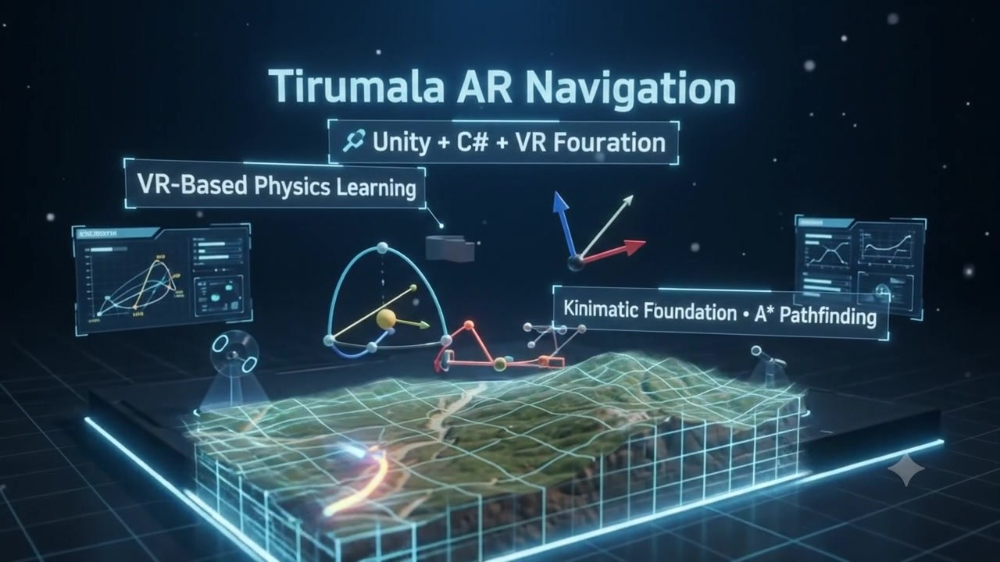 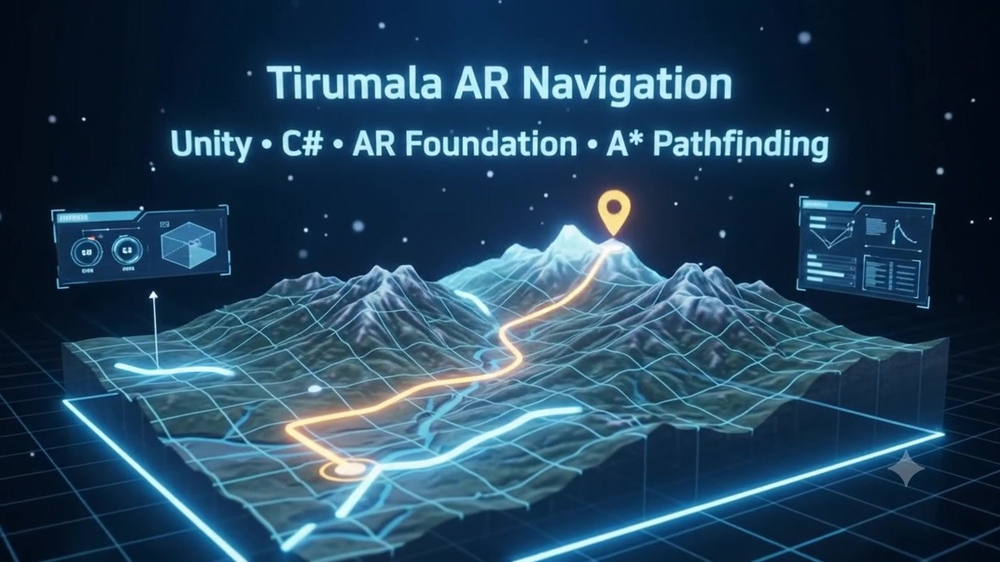 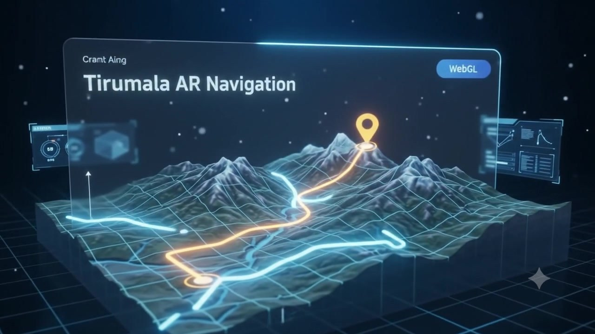

- **Diorama:** a hologram terrain slab. Build the heightmap from real SRTM / open DEM data for the Alipiri → Tirumala hills if available, otherwise sculpt it. The slab has glowing cyan box edges and sits on the **BG11** grid floor.
  - Surface: wireframe mesh plus a translucent cyan-teal skin with snow-capped peaks.
  - Small HUD panels float at the left and right.
  - Secondary **cyan paths** (UV-scrolled) run alongside.
  - The **route** runs from a start ring to an **amber pin** at the summit.
  - Show the **1.17 km interpolated gap** from `challenge` as an amber dashed segment with a flag (truthful detail from the data).
- **Feature beats:** **T19** builds the terrain (p 0.05–0.25), then **T18** draws the route (p 0.3–0.5). The route's leading tip glows. The pin drops in with a ripple ring.
- **Case-file layout (KF59):** a large glass **backplate** behind the terrain with the title at the top left, a small kicker above it and a `WebGL`-style pill at the top right (use `tag`).
- **Exit: T21** (hard push), or **T20** if the cinema mission is hidden.

#### CH10 · VR Cinema Platform (cinema, no reference) — 160 vh
- Build it in the same language: a curved cinema screen inside a **wireframe dome** (cyan lines, violet fill light), a 360° playback sphere showing a stereoscopic side-by-side test pattern, padlock/shield glyphs orbiting it (Argon2 · JWT · AES from `hud[]`), and BG08 behind.
- **Feature beat:** the screen powers on (a scanline sweep), the sphere unfolds from the screen, then the lock glyphs snap into an orbit ring.
- **Case-file:** dark glass card like CH11, with the `live` link prominent.
- **Exit: T20** (whip-pan).

#### CH11 · ISRO Launch Pad Simulation (hangar) — 160 vh
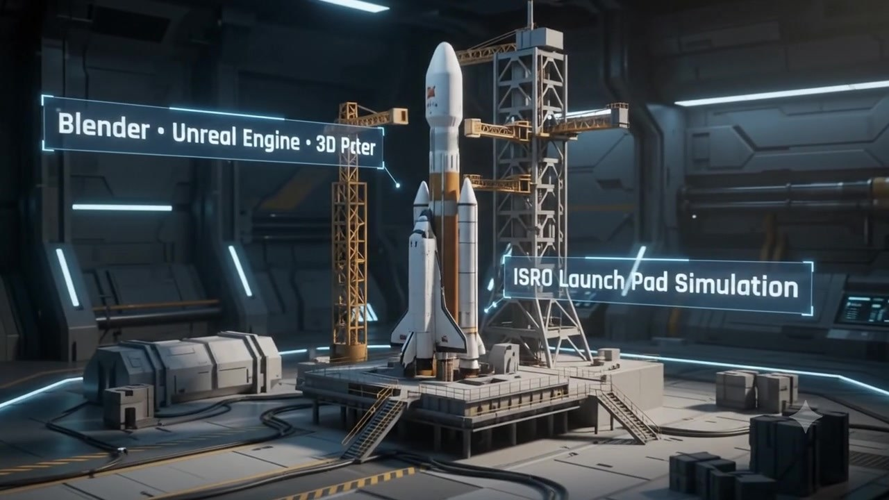 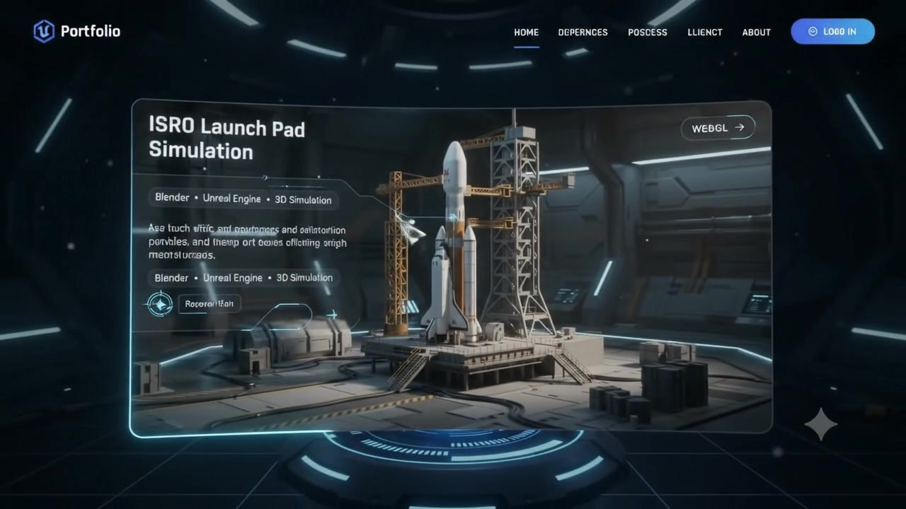

- **Diorama:** a photoreal-styled PBR hangar.
  - White rocket with orange boosters on a launch pad
  - Lattice service gantry with an orange crane arm
  - Fuel tanks, crates and cables
  - Hangar shell with cyan strip lights (BG12)
  - Floor teleport rings
- **Floating labels (KF32):** `Blender • Unreal Engine • 3D Simulation` (top left, angled) and the title on a glass plaque on the right.
- **Feature beat:** the gantry arms swing back 25°, vents release steam (particles), and the strip lights pulse once.
- **Case-file layout (KF60):** a large glass card with a cyan edge glow floating in front of the hangar. Title at the top left, tag line, two-line description, a `→` pill at the top right. The rocket stays visible through the glass. A floor ring sits below.
- Show the `context` line ("Built during the IIIT Sri City summer internship…"). Keep `verify` semantics.
- **Exit: T22** (shrink into orb + logos fly in).

### CH12 · Abilities (tech constellation) — 160 vh
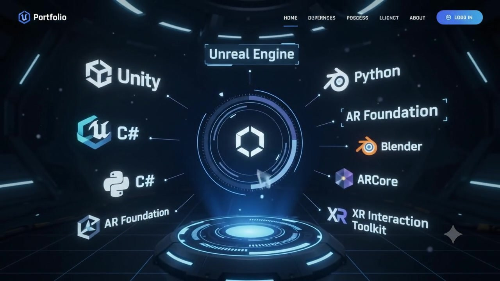 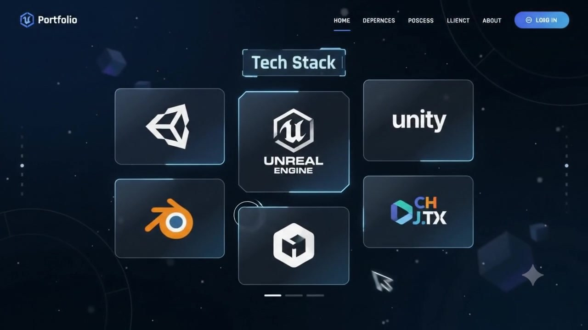

- **Centre:** the hexagon emblem (site emblem) inside rings on a **teleporter pad**, whose concentric emissive rings pulse (BG09).
- **Nodes:** ability nodes on an arc around it, in the KF34 layout. Each is a 3D logo plus a label in `--type-label` 600 white, with thin connector lines to the centre.
- **Data:** nodes come from `abilities` (filtered by `verify`) with the existing `abilityCross` layout logic. Violet tone marks AI nodes and cyan the rest.
- **Hover/focus a node:** its connector brightens, the node scales 1.08, and a dark-glass tooltip shows `role` and `blurb`. Click to list `usedIn` evidence chips, each jumping to its chapter.
- **Background:** BG09 diagonal light streaks. The emblem rotates 10 °/s.
- **Grid view toggle** (top right; default on phones): KF61 dark glass tiles in a 3×2 / 4×N grid with blue edge glow, where hovering tints the tile with the tool's brand colour (**T43**).
- **Exit: T24** (particle torus) into the Player Log.

### CH13 · Player Log (about + experience) — 220 vh
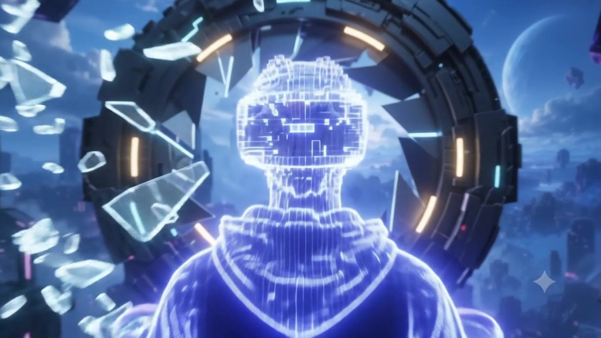 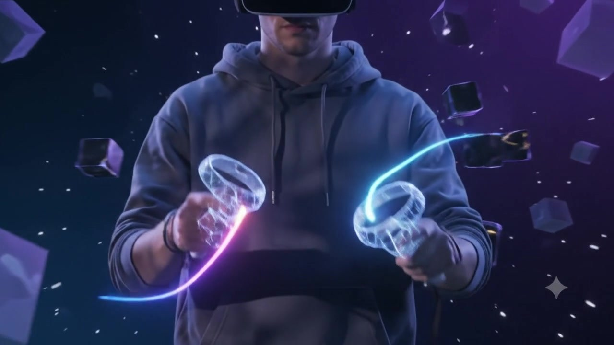 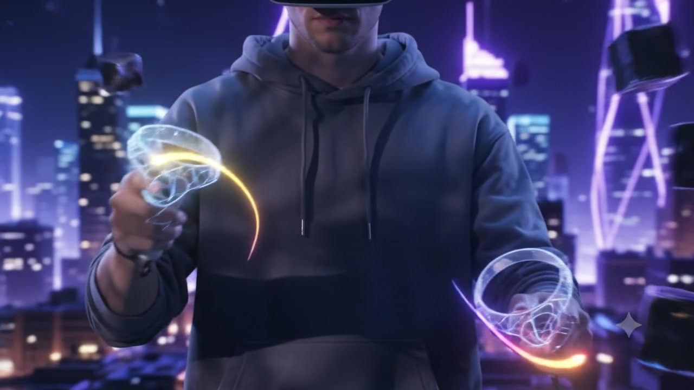

- **Enter:** **T24** reveals the player as a **blue hologram**. Then **T32** runs in reverse (p 0.05–0.2) so the hologram resolves into the solid player, now **facing the camera** in a mid shot: hoodie, headset, glass/holo controllers.
- **Main beat, T33:** the controllers emit neon ribbons (pink → violet, cyan → blue). Each `log` entry (education, experience, award) appears as a dark-glass holo panel left and right of the player while a trail "writes" a connector line to it. Entries are spaced evenly over p 0.2–0.85, and the camera orbits ±12°.
- **Background:** violet space with floating cubes (BG04/BG08) for p < 0.5, cross-fading to the **neon night city** (BG05) for p > 0.5, as in P6 3.5–4.4.
- The `nextObjective` line closes the chapter as a small HUD tag.
- **Exit: T34.**

### CH14 · The Vault (all work + side quests) — 240 vh
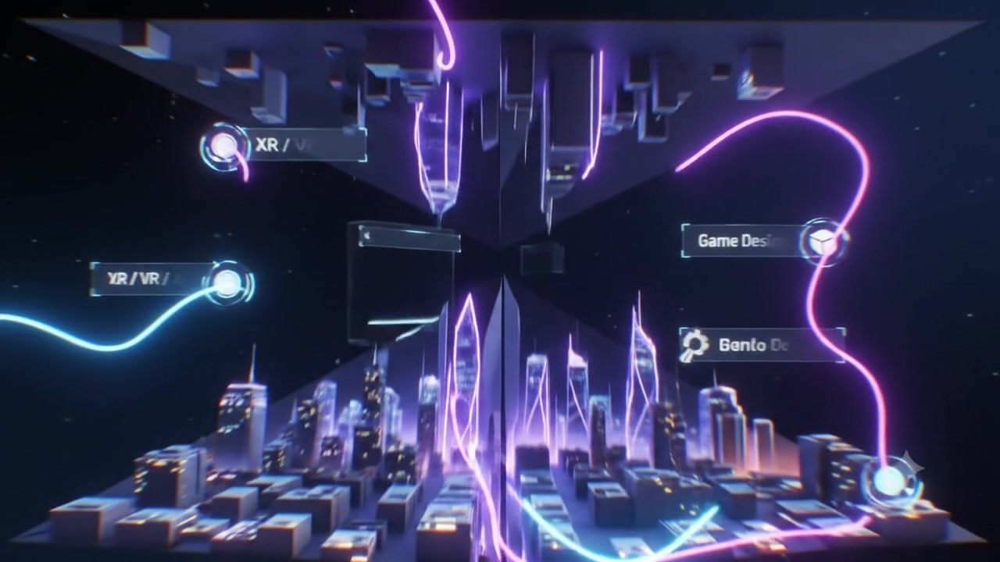 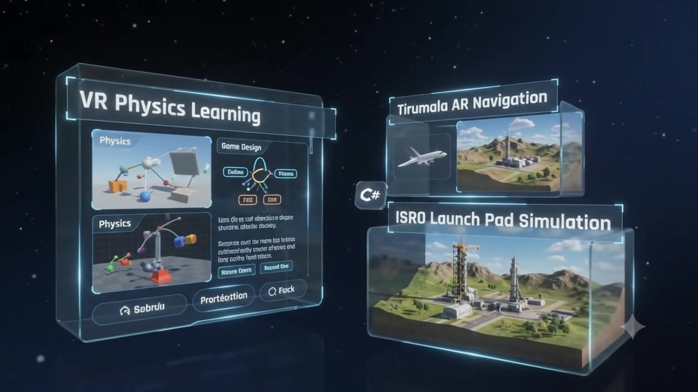 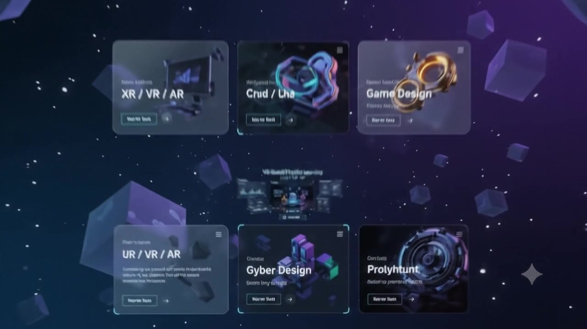

- **Enter, T34:** the world pulls back into a floating curved panel in space, which unfolds into an "inception fold" diorama with the city on both the floor and a mirrored ceiling. Neon trails snake through with node circles that hold glass tags (`XR / VR / AR`, `Game Design`, `3D & Simulation`, `AI/ML`, `Web`).
- **T35:** **glass vitrines** for every mission. These are thick chamfered glass boxes with a title bar on top and the mission's mini-diorama inside (reuse the CH08–CH11 worlds at LOD 2). Layout per KF69: a large vitrine on the left, two stacked on the right, a small `C#`-style badge between them. The rest of the time they float idly.
- **Side quests** (p 0.6–0.85): `sideQuests` appear as a **dark glass card grid** (KF55: 3 columns, chrome 3D icon at the top right, title, two-line summary, stack chips, small arrow button) via **T27**. Clicking a card plays **T28** (split-and-zoom) into a detail dialog, which links to GitHub.
- **Filtering:** when entered from a menu tag, matching vitrines and cards stay lit and the others dim to 25 %.
- **Exit: T36.**

### CH15 · Finale / Comms — 120 vh + normal flow
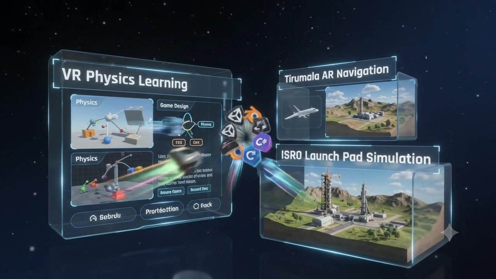 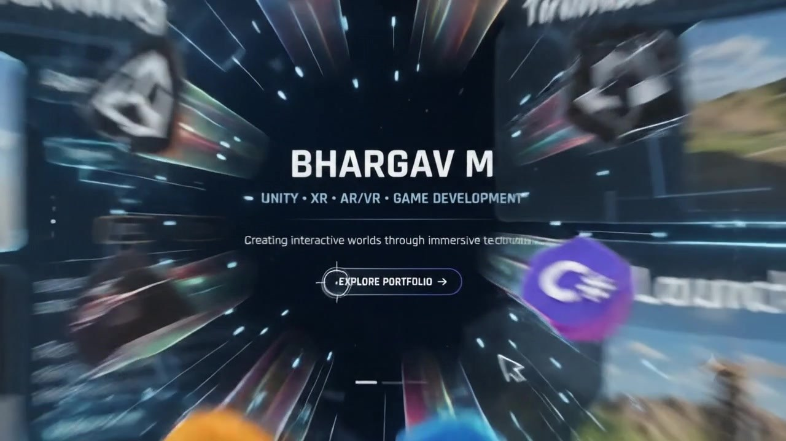 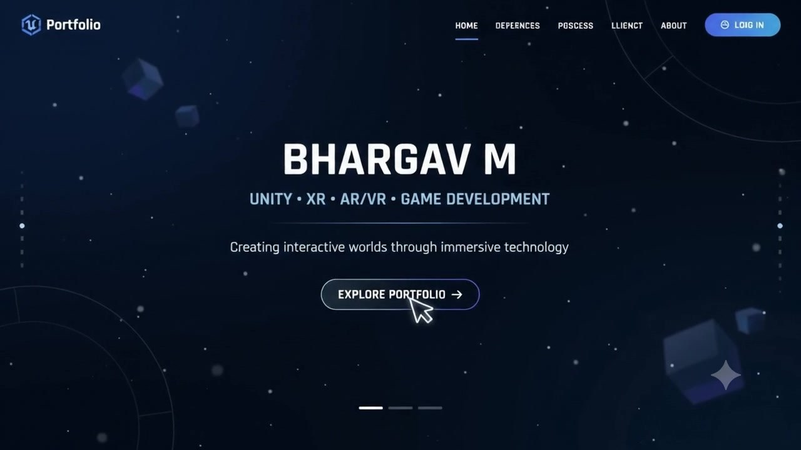

- **Sequence:** **T36** (logos converge) → **T37** (hyperspace zoom through) → **T25** (settle).
- **Final layout at 1280×720 (KF36), centred:**
  - **BHARGAV M** at y ≈ 35 % (`--type-identity`, `--text-hi` with a subtle downward gradient to `#C9D3E8`)
  - role line `UNITY • XR • AR/VR • GAME DEVELOPMENT` at 44 % (`--type-role`, `--text-sub`)
  - a 1 px divider at 49.5 %, 32 % vw wide, gradient transparent → `#6D8FD8` → transparent
  - `Creating interactive worlds through immersive technology` at 55 % (`--type-body-l`, `--text-body`)
  - CTA **EXPLORE PORTFOLIO →** at 62–69 %, 253×50 at 1280 (§7.4); clicking it plays **T14** back into the menu
  - three pagination dashes at 90.5 % (38×3 px each, 10 px gap, the first white, the others `#3A4660`) marking ENTRY · WORLD · COMMS
- **Background:** BG01, glass cubes at the top left and bottom right (BG04), HUD arcs (BG10), side rails (BG15) and a radial `--navy-1 → --void-1` gradient.
- **Then normal flow (no pin):** the existing contact terminal (Firebase, `CONTACT_LIMITS`) restyled in dark glass, the links from `links` (email, LinkedIn, GitHub), and a footer with `REPLAY ENTRY`, `LITE MODE` and `ARCHIVE`.

---

## 6 · `/archive` — the daylight side of the portal

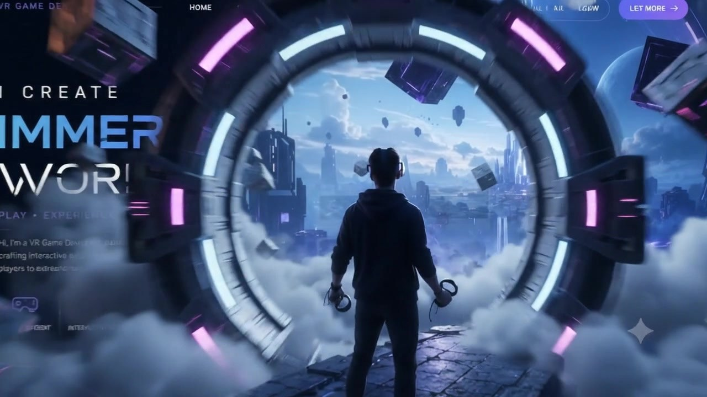 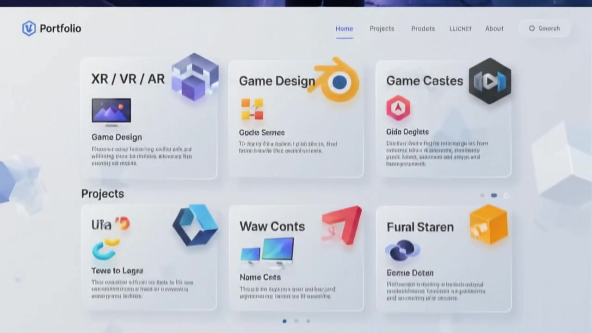 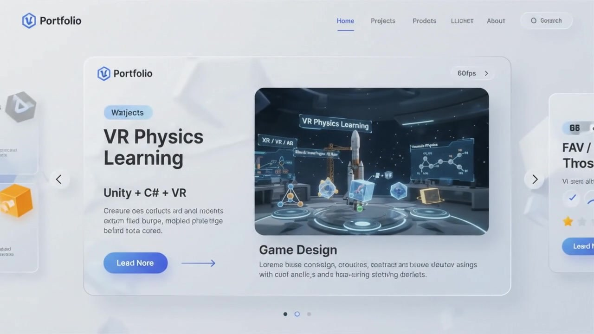 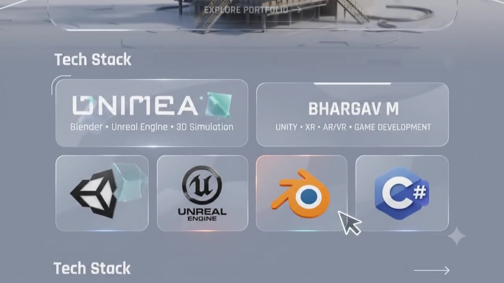

This route is fast and conventional, and doubles as the Lite destination. It uses light glass (§3.4–3.5) over BG13.

- **Arrival from Home:** **T41** (metallic ring fly-through into daylight; the player becomes a glass window), then **T42** (the glass dashboard dollies in).
- **Header:** light glass nav (logo + Home · Missions · Side Quests · Tech · Back to NEXUS), active item underlined in `--day-accent`.
- **Sections** (paged with **T38** vertical slides, wheel-snapped):
  1. **Domains:** three light-glass cards (XR / VR / AR, Game Design, 3D & Simulation) with glossy 3D icons (KF43 top row).
  2. **Missions carousel, T39** (KF44, KF45): a featured card ~62 % wide containing:
     - a tag pill, title, stack line and description
     - a `--day-accent` "Learn More" pill and an arrow link
     - a render image on the right, taken from your 3D scene, not the footage
     - neighbours peeking at 0.88 scale and 60 % opacity, `‹ ›` buttons, and dots
  3. **Side quests:** a light-glass grid.
  4. **Tech stack** (KF46, KF53): 2×4 frosted tiles with the tool logos; hover tints them (**T43**).
- **End:** `RE-ENTER THE NEXUS` plays **T40** (tiles dissolve into the BHARGAV M hero) and routes to `/#home`.
- The full portal (T41/T42) runs only when navigating from Home. Otherwise arrival is **T38**.

---

## 7 · Components

### 7.1 HUD frame (SVG, screen-anchored, `aria-hidden`)

| Part | Spec (at 1280×720; scale with `--hud-inset` and vw) |
|---|---|
| Frame | Inset 2.35 % vw. 1 px `--hud-cyan` at 60 % with a 6 px `--hud-glow` blur. Corners chamfered 18 px at 45°. Short ticks at each edge midpoint. Small `◂ ▸` markers at mid-height on the outer edges |
| TL module | x 4.3–16 %, y 6–15 %. Title in `--type-hud-title` (`ACTIVATION [02]`, `WORLD ENTRY - [02]`) with `[nn]` in brackets. Below: 1–2 mono lines and 3 progress bars (160×3 px, track at 15 %) |
| TR module | Right-aligned, 4–6 lines of `--type-micro` at 55 %. **Real strings only** (e.g. `BUILD 2026.10`, `UNITY 6 · URP`, `NODE 13.55N 80.02E`, `LINK 11 ms`) |
| Side arcs (Gate / VR) | Left arc centre x 17.6 %, spanning y 19–72 % (≈ 53 % vh). A thick 5 px gradient segment over its middle 60 %, a 1 px outer arc offset 20 px, a tick ladder, a horizontal pointer line toward the centre and labels `[01]` `[02]` `[03]`. The right arc mirrors it at x 82.4 % |
| BL module | x 4.7–15.2 %, y 80–92 %. Three rows of 12 px icon + 110×3 bar (SYNC / SIGNAL / LINK) |
| BR module | x 82–95 %, y 80–92 %. A three-digit counter in Chakra Petch 600 (26 px) with a flip-tick (each digit slides y −100 % in 0.12 s), sub-label `0/003`, and a 3-cell footer |
| Top ruler (C2) | x 35–65 %, y 6 %. Ticks every 10 px with labels every 50 px, plus a `▼` marker (VR) |
| Bottom title (C2) | Centred at y 87 % in `--type-hud-display` with `--hud-cyan-2` and `text-shadow 0 0 12px rgba(120,216,239,.6)`. A bracketed underline 30 % vw wide |
| Reticle (VR) | Square corner brackets (26 px arms) around a box 22 % vw wide, a 12 px centre cross, and two parenthesis arcs at x 28 % / 72 % |

Boot order and timings are given in T01. Shutdown is the reverse at 1.5× speed.

### 7.2 Plasma portal (shader + geometry)

- **Geometry:** a membrane disc (128 segments), a thin rim torus, and an outer ring. The Gate uses a thin dark band. World Entry, the Hub and VR use a **segmented mechanical torus**: 24 panels with panel lines and emissive slits (`--hud-cyan` or `--route-glow` per variant).
- **Membrane fragment shader** (polar `r ∈ [0,1]`, angle `θ`):
  - **swirl:** `θ' = θ + twist·(1−r)² + time·ω`
  - **base:** `n = fbm(domainWarp(vec2(θ'·3.0, r·4.0)))`
  - **filaments:** `f = pow(1 − abs(fbm2·2 − 1), 6.0)` (ridged, thin bright lines)
  - **colour:** `mix(--plasma-deep, --plasma-mid, n) + f·--plasma-hot·filamentGain`
  - **rim:** `smoothstep(.90, .985, r)·rimGain·(0.85 + 0.15·flickerNoise)`
  - **core:** `exp(−r²/σ²)·coreGain`, where σ grows from 0.02 to 0.30 during the blooms
  - **window:** `alpha = mix(1.0, 0.45·smoothstep(0., .8, r), windowAmount)` blended over the **destination render target** (the city), sampled with a refraction offset of `0.02·∇n`
- **Scrubbed uniforms:** `twist 0→3 turns`, `ω 0→2.4 rad/s`, `rimGain 1→1.8`, `windowAmount 0→1`, `coreGain`, `σ`.
- **Lightning:** CPU midpoint-displacement polylines (5 levels, branching probability .3) running from the rim outward, drawn with `Line2` in additive violet-white. Each arc lives 120–200 ms, with **at most 3 per second** and a small screen area.
- **Particles:** GPU points spawned on the rim with tangential plus outward velocity, 1.5–4 px, additive, twinkling.

### 7.3 Glass card / chip / vitrine

- **Card:** a DOM element styled with dark or light glass (§3.5). A 1 px inner highlight on the top edge, a 12–16 px header row (kicker + pill), title in `--type-card-title`, body in `--type-body`, and chips in `--type-label` inside 10 px-radius glass.
- **3D panels:** use drei `<Html transform occlude>` only where the panel must sit in depth (case-file panels, menu chips). Everything else is DOM over the canvas.
- **Vitrine:** chamfered box glass (`MeshTransmissionMaterial`), a title bar as an SDF text plane, the inner diorama as a scene at LOD 2 with its own light, and an idle float of ±6 px over a 4 s period.

### 7.4 CTA pill (EXPLORE PORTFOLIO)

| State | Spec |
|---|---|
| Rest | 253×50 at 1280 (`min-height 44px`), radius 999. Fill `--cta-fill`, 1.5 px border `--cta-stroke`. Text in `--type-cta` white with a `→` icon gap of 10 px. On first appearance only: a **targeting reticle** (circle, 64 px, 4 crosshair ticks) centred on the pill's left end scales 1.4→1.0 over 0.2 s and fades by 0.3 s (P1 8.8–9.1) |
| Hover / focus | Fill → `--cta-fill-hover` (0.25 s), border brightens 20 %, arrow nudges +4 px. Focus adds a 2 px `--hud-cyan` ring with 3 px offset |
| Active | Concentric double-ring ripple at the pointer (two 1 px circles, 12→36 px, 0.35 s, fading), scale .98 |
| Disabled | 40 % opacity, no ripple |

### 7.5 Menu chip, ability node, dark/light tile

| Element | Default | Hover / focus | Active / selected |
|---|---|---|---|
| Menu chip | Dark glass, `#E6ECF5` text, 1 px `--menu-label` stroke at 35 %, cyan L-corners | Lift 4 px, stroke 80 %, corners glow, connector lit, cube turns toward it | Plays T16, `aria-pressed` |
| Ability node | Logo + label at 85 % | Scale 1.08, connector 100 %, tooltip | Evidence chips expand |
| Dark tech tile (CH12 grid) | `rgba(16,24,44,.55)`, blue edge glow at 30 % | Lift 4 px, brand tint 25 % (T43), glow 60 % | n/a |
| Light tile (`/archive`) | Light glass | Lift 4 px, brand tint 35 % (Blender `#F5792A`, Unity `#FFFFFF`→dark, C# `#68217A`, Unreal `#0E1128`) | n/a |
| Carousel card | Neighbours at 0.88 scale / 60 % | Featured: lift 6 px, scale 1.03, cyan rim pulsing over 1.6 s (T39) | n/a |

### 7.6 Nav

KF36 layout: a logo at the left (x 2.7 %) made of a hex emblem plus the wordmark (use "NEXUS", or "BHARGAV M"; the footage shows "Portfolio").

- **Links** in `--type-label` 600 with a 36 px gap, right-aligned to x 86 %: **HOME · MISSIONS · ABILITIES · PLAYER LOG · ARCHIVE**.
- **Active link:** a 2 px `--nav-active` underline the width of the label, sliding between items over 0.35 s (`power3.out`).
- **Pill** at x 88–97.5 %, 120×36: `--nav-pill` gradient with an icon and **COMMS**. This replaces the footage's meaningless "LOG IN".
- Hidden during CH00–CH04 and SE, where only `SKIP INTRO` and the sound toggle show (top right). It fades in over 0.3 s on CH05 and, on phones, collapses to a menu button that opens a full-screen glass sheet.

---

## 8 · Transition library (T01–T43)

### 8.0 Shared machinery

- **Camera transitions** (one continuous world): T02–T06, T09–T13, T15, T18, T19, T31–T33, T35–T37. These are GSAP timelines on `rig.camera` and material uniforms.
- **Screen-space transitions** (two worlds): render world A and world B into `WebGLRenderTarget`s (half-float, MSAA 4 on the high tier) and composite them in a custom **TransitionPass** (`postprocessing` `Effect`). Uniforms are `progress`, `mode`, `center`, `radius`, `dir`, `blur` and `seamColor`. Modes:

| Mode | Used by | Composite (uv in 0–1) |
|---|---|---|
| `SLIT_DOORS` | T17 | `g = ease(p)·0.5`. If `|uv.x−.5| < g`, sample **B** at `uv` scaled from 1.12 → 1.0 about the centre. Otherwise sample **A** at `uv.x − sign(uv.x−.5)·g` with a horizontal blur of `0.06·sin(πp)`. Draw a 2 px `seamColor` line at `|uv.x−.5| = g` for p < .35 |
| `WHIP` | T20 | A at `uv + (p,0)`, B at `uv + (p−1,0)`, directional blur peaking at 6 % vw, roll 2° |
| `PUSH` | T21 | Same as WHIP with **no blur**, `power4.inOut`, and a 1 px bright seam |
| `IRIS` | T26 | B where `distance(uv·aspect, center) < radius(p)`, with a 0.02 feather |
| `VSLIDE` | T38 | A at `uv + (0,p)`, B at `uv + (0,p−1)`, vertical blur peaking at 4 % vh |
| `RADIAL_ZOOM` | T04 T07 T37 | Zoom blur toward `center` (16 taps), strength curve per transition, plus additive white |
| `SHRINK` | T22 T30 | A scaled into a rect or circle (`radius(p)`) over B, with lens distortion `k = 0.15·p` |
| `DISSOLVE` | T40 | Noise-threshold dissolve (`fbm(uv·6) < p`) with a 1 px `--hud-cyan` edge |

- **Teleport under cover.** For nav jumps, play the signature transition time-based. At the moment the screen is fully covered (white-out, black silhouette, full streak field or a full ring), call `lenis.scrollTo(target, {immediate:true})`, mount the target world, and finish the transition into it.
- Every transition has a **reduced-motion fallback**: a 200 ms opacity crossfade, or an instant cut for the white and silhouette covers.

### 8.1 Entry transitions (C1, C2, VR)

**T01 · HUD boot + particle swarm** — C1 2.3–4.0 s (1.7 s) · CH00 (time-based) and CH01 p .23–.40
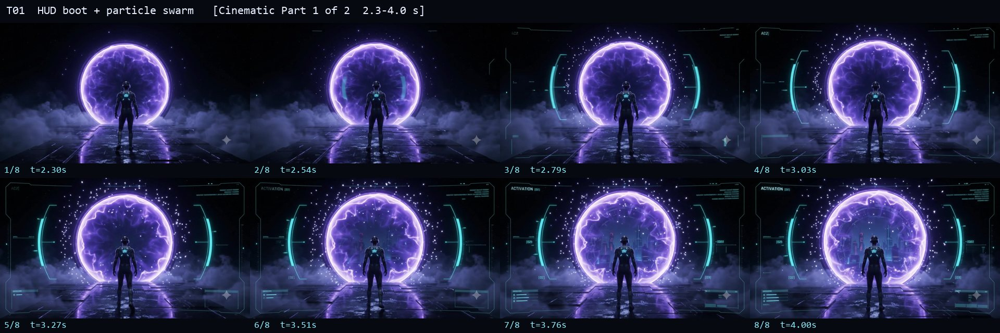
1. **2.4 s:** the side arcs draw outward from their pointer ticks (`stroke-dashoffset`, 0.4 s, `power2.out`).
2. **2.6 s:** a small TL label appears. The frame lines draw from the four corners along the edges (0.6 s, `power2.inOut`).
3. **2.8 s:** the particle swarm spawns at the rim: 400–600 points orbiting outward in a loose spiral (ω .6 rad/s, radial drift .05 R/s).
4. **3.4–3.6 s:** the TL title glitches in (3 frames of slice offsets), the BL bars fill to 40/60/75 %, and the BR counter rolls `000→003`.
5. **3.6–4.0 s:** the labels `[01]` `[02]` `[03]` fade in, staggered 0.06 s.

**T02 · Plasma membrane becomes a window** — C1 3.4–4.6 s · CH01 p .34–.46
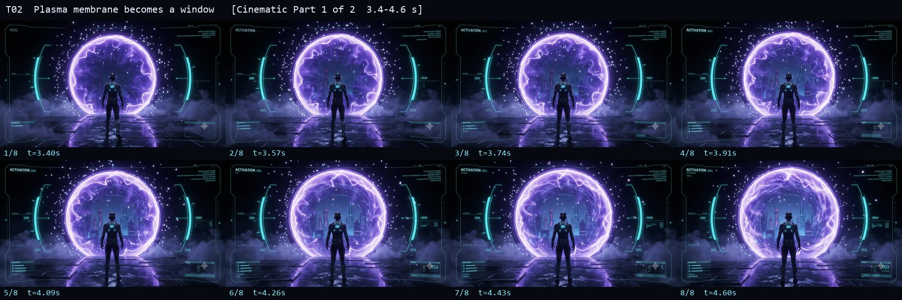
- `windowAmount` 0→1 (`sine.inOut`, 1.2 s) reveals the neon city render target behind the membrane, which starts out of focus (bokeh) with pink and cyan accents.
- The turbulence changes from chaotic to tangential flow. The rim brightens 10 %.

**T03 · Vortex spin-up + ease-in push** — C1 4.5–7.9 s · CH01 p .45–.80
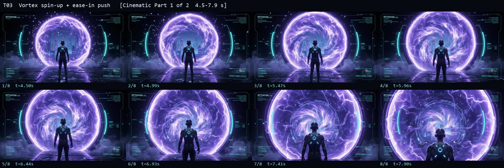
- `twist` 0→3 turns and `ω` 0→2.4 rad/s (`power2.in`). Rim gain 1→1.8, rim thickness +40 %.
- **6.8 s:** concentric "tunnel" rings appear deep inside the vortex.
- **7.0 s:** lightning starts leaking from the rim into the HUD zone (≤ 3/s).
- Camera per the CH01 dolly curve. Frame motion climbs from about 5 to 15 (contact sheet `C1_06.0-07.9s`).

**T04 · Pass the figure → core flare → white-out** — C1 7.8–9.9 s · CH01 p .79–1.0
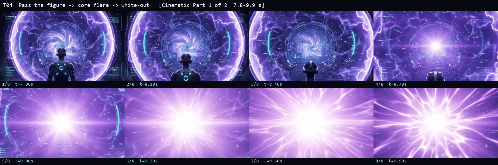
1. **7.8–8.5 s:** the camera accelerates (`power3.in`) over the avatar's head; the avatar exits through the bottom of the frame.
2. **8.5 s:** a white core ignites at the vanishing point (0→8 % vw) with an anamorphic horizontal streak (full width, 2→6 px).
3. **8.8–9.1 s:** the HUD fades out (0.3 s) while bloom rises 1.2→6.
4. **9.0–9.9 s:** 40–60 radial lavender filaments, and screen luma ramps to about 82 % following `--whiteout-ramp`. This is a single slow ramp, not a flash.

**T05 · WORLD ENTRY HUD → threshold crossing** — C2 0.0–3.2 s · CH02
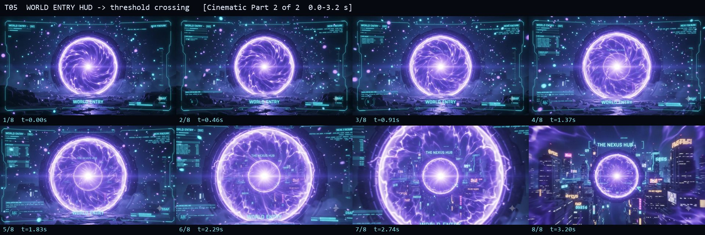
- See the CH02 beats.
- At the crossing (2.8–3.1 s), plasma tendrils smear across the frame edges (radial blur .35), luma peaks, and the frame then drops to the darker city.
- The HUD frame and its modules scale outward 1→1.12 and fade at the edges first (radial mask).

**T06 · "[ THE NEXUS HUB ]" title + second portal** — C2 3.0–4.5 s · CH03

- **Title:** the brackets slide apart from the centre to ±20 % vw (0.4 s, `power3.out`). The text fades in while its letter-spacing tightens from .30em to .12em. The `[09` tags pop in (scale .8→1, `back.out`).
- **Second portal:** grows from 35 % vw to beyond the frame. Radial streaks erupt from inside it from 3.6 s, and the camera enters at 4.3–4.4 s.

**T07 · Hyperspace corridor → ribbon warp** — C2 4.4–9.9 s · CH04 p 0–.62

- **Streaks:** 600–1,200 instanced quads in a cylinder around the camera rail, stretched along the view direction by speed and respawned once passed.
- **Wormhole mouth:** a dark smoky mouth at the centre (≈ 10 % vw radius), drawn as layered billboard smoke with a violet rim. Violet lightning starts at 7.0 s.
- City towers line both sides.
- **Phases:**
  - 4.5 s: the HUD frame returns at 70 %
  - 6.0–7.0 s: long cyan laser rails cross diagonally
  - 8.0–9.9 s: streaks bend into sinusoidal ribbons (amplitude 2–6 % vw, 2–3 waves across the screen), and the bottom `WORLD ENTRY` title fades back in
  - last 0.3 s: zoom blur ramps up
- The L/R arc brackets rotate ±4°. Motion stays at 25–50 per 0.1 s throughout (constant high speed).

**T08 · Silhouette pass-through wipe** — VR 1.2–2.1 s · SE p .15–.27

1. **1.3 s:** lock-on. A cyan double-arc ring appears around the player's head (scale 1.3→1.0, 0.2 s, `back.out`).
2. **1.3–1.9 s:** the camera rushes from 6 m to 0.2 m (`power4.in`); motion peaks at 78.
3. **1.9 s:** the player's black silhouette fills the frame. Use the character's alpha/depth as the matte that switches to the first-person world.
4. **2.0 s:** a first-person view with the reticle HUD and radial star streaks.

**T09 · Reticle expand + white-core bloom** — VR 3.9–6.0 s · SE p .50–.76 and CH04 p .62–.80

- The parenthesis arcs scale 1.0→1.9 to the frame edges (4.0–5.1 s, `power2.in`). The square reticle stays fixed and the streaks fade (4.3–4.8 s).
- The portal grows to 76.6 % (5.7 s).
- **5.5 s:** core plus anamorphic flare.
- **5.6–6.0 s:** bloom to near-white (luma 200).

**T10 · Warp exit → city flyover** — VR 6.0–7.9 s · SE p .76–1.0 and CH04 p .80–1.0

- **6.0–6.7 s:** a white-violet streak tunnel with brackets expanding past the edges.
- **6.8–7.1 s:** bloom recedes (luma 186 → 90) and the streaks decelerate (length 1→0.1), each **morphing into a window light** of the city.
- **7.1–7.9 s:** a steady glide (motion 26–32). In our build this resolves into the Home vista (CH04 note).

### 8.2 Home → menu transitions (P1, P2)

**T11 · Hero push-in + copy slides out** — P1 1.0–2.0 s · CH06 p 0–.42, and the first beat of every Home nav jump

- The scene dollies in about 1.25× (`power1.inOut`).
- The copy column moves x 0 → −18 % vw and fades. It moves **1.6× faster than the scene** (parallax) and the left edge clips it.
- Headset LEDs ignite at 1.5–1.6 s (emissive 0→3, `#5A8BFF`). Cubes drift outward.

**T12 · Holo HUD materialises around the head** — P1 2.0–2.8 s · CH06 p .42–.75

- 3–5 holographic rings (`#9FD0FF`, 1–2 px, 60 %) draw around the head over 0.5 s, staggered 0.05 s.
- Data panels with mini charts pop in to the left and right (scaleY 0→1, 0.25 s, staggered 0.08 s).
- The camera reaches the back of the headset. At 2.6 s the visor's screen shows the menu.

**T13 · Visor dive + goggle mask** — P1 2.7–3.4 s · CH06 p .71–1.0

- **2.7–2.95 s:** extreme push. FOV narrows 35°→22° with motion blur.
- **3.0 s:** **cut on maximum motion** (motion 84, the highest in the set) to a POV inside the goggles. A black two-lens mask (rounded lenses, nose-bridge cut-out, inner vignette) frames the menu.
- **3.1–3.3 s:** the mask scales 1→1.6 and fades, and the menu fills the screen.

**T14 · Droste double-visor** — P2 2.8–3.9 s · Finale CTA → CH07

- Inside the first goggle view, the HUD centre contains **another headset**. The zoom continues into it (scale 1→6, 0.4 s, `power2.in`), revealing a second goggle mask and then the menu.

**T15 · Menu cube → orb lens → scene** — P1 3.4–4.0 s · CH07 p .67–1.0, and the PROJECTS chip

- The cube morphs into a glass sphere (vertex morph, 0.15 s). The sphere shows the destination scene inside it (render target with a fisheye refraction).
- It grows from 12 % vw past the frame (`power3.in`, 0.4 s) while the chips drift outward and blur.

**T16 · Labels explode past the camera** — P2 4.3–4.9 s · menu chip click

- The seven chips fly out along radial vectors and toward the camera (z +2.5 m, scale 1→2.4, motion blur, fading at the frame edge) while the centre preview zooms (0.5 s, `power2.in`).

### 8.3 Mission transitions (P1, P2, P5)

**T17 · Centre-slit door split** — P1 4.6–5.2 s · CH08 → CH09

- `SLIT_DOORS`, 0.45 s, `power3.inOut`. The seam appears at 4.69 s and is fully open by 5.03 s. B starts at scale 1.12.

**T18 · Route path draws to the pin** — P1 5.0–5.8 s / P5 5.0–6.8 s · CH09 feature beat

- A tube geometry follows the terrain spline; `drawRange` 0→1 over 0.6 s (`power1.inOut`) with a glowing tip.
- The start ring pulses. The pin drops from +0.3 m (0.25 s, `back.out(2)`) with a ripple ring.

**T19 · Terrain wireframe extrusion build** — P2 5.3–6.3 s · CH09 enter beat

- A sweep plane moves right → left. Tiles behind it rise from 0 (scaleY with an x-based stagger) as wireframe, then crossfade to the textured skin over 0.3 s. The sweep front carries a cyan glow.

**T20 · Whip-pan** — P1 5.8–6.4 s / P4 6.9–7.4 s · CH10 → CH11, `←`/`→` mission nav

- `WHIP`, 0.4 s, `power3.inOut`.

**T21 · Hard-edge push** — P2 6.3–6.8 s · CH09 → CH10, deep-link arrival

- `PUSH`, 0.22 s, `power4.inOut`.

**T22 · Shrink into orb + logos fly in** — P1 6.9–7.4 s · CH11 → CH12

- `SHRINK` the hangar into an orb on the teleporter pad (100 % → 18 % vw, 0.35 s, `power3.inOut`).
- The ability logos fly in from the screen edges to their slots (0.35 s, `power3.out`, staggered 0.03 s) using **T36** comet trails. The nav fades in if it is hidden.

**T27 · Glass cards materialise** — P5 1.5–2.2 s · case-file panels (CH08–CH11), side-quest grid (CH14)

- Scene exposure drops 1→0.55 and depth of field opens. Cards fade in (opacity 0→1, scale .94→1, y 20→0 px, 0.45 s, `power2.out`, staggered 0.06 s).

**T28 · Split-and-zoom** — P5 2.6–3.6 s · side-quest / archive card click

- The row above the clicked card moves up −60 % vh and the row below moves down +60 % vh (0.6 s, `power3.in`, blur). The clicked card scales 1→3.2 toward the camera and becomes the detail view.

**T29 · Panel door-swing** — P5 4.6–5.1 s · OPEN CASE FILE (reverse to close)

- The side panels rotate Y ±75° about their outer edges (`perspective 1200px`) while the centre window scales up into the dialog (0.45 s, `power3.in`, blur on motion).

**T30 · Card shrinks into the next scene** — P5 6.9–7.4 s · case-file close

- The detail and its backplate scale 100 % → 42 % vw while sliding to the case-file card's position in the scene, then dock into it (0.45 s, `power3.inOut`).

### 8.4 Abilities → Player Log → Vault → Finale (P1, P2, P6)

**T23 · Portal burst energy ring → hero** — P1 8.0–8.9 s · nav COMMS pill

1. The emblem flashes (bloom spike 0.1 s).
2. A cyan energy ring (a thick torus of particles plus lightning) expands from 10 % to 140 % vw (0.6 s, `power2.out`). Its interior reveals the Finale (`IRIS` with radius = the ring).
3. Outside labels fly past the camera with radial star streaks. The hero text enters at scale .92→1.

**T24 · Particle torus burst** — P2 8.6–9.5 s · CH12 → CH13

- The emblem collapses into a wobbly torus of 3,000–8,000 points with noise displacement (a "sound-wave" look). It expands like T23 (0.9 s) and reveals the player hologram.

**T25 · Final settle + CTA reticle + hover** — P1 8.8–9.9 s · CH15 end

- The CTA reticle appears and then disappears (§7.4). The cubes ease to their idle positions and the pagination fades in. Motion falls to about 1 (still).

**T31 · Mechanical ring assembles** — P6 1.1–1.9 s · nav PLAYER LOG from Home

- 24 dark-metal segments, each with `--route-glow` and `--hud-cyan` light slots, fly in along arcs from left, right and top and lock into a ring around the player (staggered 0.02 s, 0.6 s, `back.out(1.2)`). T11 runs at the same time.

**T32 · Glass shatter + hologram digitise** — P6 1.9–3.1 s · nav PLAYER LOG (forward) and CH13 entry (hologram → solid)

- **1.9–2.6 s:** the ring's membrane fractures (Voronoi, 150–300 instanced shards) that swirl and fly toward the camera.
- **2.3–3.0 s:** the player becomes a hologram: Fresnel rim, scanlines, voxel quantisation of the vertices (step grows), and a `#6B8BFF` wireframe overlay.
- **3.0 s:** the hologram dissolves to reveal the solid, front-facing player.

**T33 · Neon light-trail ribbons** — P6 3.4–4.4 s · CH13 main beat

- Ribbons are 6–10 px wide with 0.8 s of history, gradient pink→violet and cyan→blue, additive with bloom, and follow the controllers.
- The background crossfades from violet space with cubes (3.5 s) to the neon city (4.0 s).

**T34 · World pulls back into a panel, then folds** — P6 4.4–5.7 s · CH13 → CH14

- **4.4–4.8 s:** a radial-blur pull-back. The whole world shrinks onto a **curved panel** (its render target on a cylinder segment) floating in deep space.
- **4.8–5.6 s:** the panel tilts back and unfolds into the 3D diorama with the city on the floor and the **mirrored city on the ceiling** (`scale.y = −1`, a shared instanced kit). Neon trails and node circles appear.

**T35 · Glass vitrines + neon node connectors** — P6 5.6–6.4 s · CH14

- Vitrines rise 0.2 m and fade in, staggered 0.1 s. Neon node lines connect the skill tags to the vitrines. The camera pushes in, then idles.

**T36 · Comet logo fly-in** — P6 7.4–8.3 s · CH14 → CH15, and the logo flight in T22

- 3D tech logos fly in from the bottom-left on curved paths. Each spins and trails a rainbow comet tail (orange → pink → cyan, 25 % vw long) before clustering in the centre gap.

**T37 · Hyperspace radial zoom to hero** — P6 8.2–8.9 s · CH15 entry

- **8.2 s:** "BHARGAV M" appears in the cluster.
- **8.3–8.7 s:** `RADIAL_ZOOM` (strength 0→.6→0) with star streaks. Logos and vitrines fly past the camera. Settle by 8.8 s (motion 28 → 7 → 1).

### 8.5 Archive transitions (P3, P4, P5)

**T26 · Iris reveal into daylight** — P5 0.4–1.2 s · hover/focus on ARCHIVE in the Home nav (reversible)

- `IRIS` centred on the spire inside the portal frame, radius 0 → portal radius (0.7 s, `power2.inOut`). It reveals the **daylight city** (white towers, greenery, `--day-sky`). Leaving reverses it.

**T38 · Vertical full-page slide with motion blur** — P3 1.1–2.1 s · archive section paging, `/` ↔ `/archive` away from Home

- `VSLIDE`, 0.7 s, `power3.inOut`.

**T39 · Glass carousel slide + hover lift** — P3 2.8–7.0 s · `/archive` missions

- Slides take 0.6 s (`power3.inOut`) with horizontal blur on the moving cards. Hover behaviour is in §7.5. Swipe, drag and arrow keys are supported.

**T40 · Tiles dissolve into hero** — P3 9.0–9.9 s · `/archive` → RE-ENTER THE NEXUS

- The centre tiles fade and blur out (8 px) in a centre-out stagger while the hero text crossfades in at the same position (scale .96→1). The outer tiles follow, then the route changes.

**T41 · Ring fly-through to daylight + figure becomes glass** — P4 0.0–2.1 s · ARCHIVE click from Home

- **0–1.1 s:** a thick metallic torus with magenta and cyan light slots scales 0.4→1.1 around the player.
- **1.1–1.6 s:** the camera flies through it and the copy slides out (T11).
- **1.6 s:** the daylight world appears (clouds, city, floating cubes, a light beam).
- **1.6–2.0 s:** the player turns to translucent glass and dissolves into a frosted glass window.

**T42 · Glass dashboard dolly + scroll** — P4 2.0–5.7 s · `/archive` arrival

- The glass window approaches (2.0–3.5 s) with cubes passing in the foreground (parallax) and fills the screen at 3.5 s. Paging inside it uses T38.

**T43 · Glass tile hover tint** — P4 8.3–9.9 s · tech tiles (`/archive`, CH12 grid)

- The brand-colour overlay goes 0 → 35 %, the tile lifts 4 px and the icon scales 1.06 (0.2 s).

### 8.6 Allocation check (every transition is used)

| Where | Transitions |
|---|---|
| Linear scroll | T01–T07, T09–T13, T15, T17–T19, T20, T21, T22, T24, T25, T27, T32–T37 |
| Short Entry | T08, T09, T10 |
| Nav / menu / CTA | T11, T13, T14, T16, T23, T26, T31, T32, T41 |
| In-chapter interaction | T27, T28, T29, T30, T43 |
| `/archive` | T38, T39, T40, T41, T42, T43 |

---

## 9 · 3D asset list and build notes

| Asset | Spec | Notes |
|---|---|---|
| Avatar (Gate) | Rigged, slim sci-fi suit, helmet visor, emissive mask for the back panel and strips. Idle: breathing and weight shift | `public/nexus/player.glb` (Mixamo X Bot) can serve as the base rig. Add a suit mesh and emissive textures |
| Player (Home, Dive, Player Log) | Rigged hoodie character with a VR headset and two controllers. Clips: idle-back, look-up, idle-front, gesture (for trails) | Use a quality stylised/realistic glTF (Ready Player Me, commercial or commissioned). Photoreal humans are out of real-time scope; say so and push material quality |
| Holo controllers | Glass ring controllers (Fresnel, `MeshTransmissionMaterial`), emissive rims | T33 |
| Portals | §7.2. Mechanical torus glTF (24 segments, emissive slits) | Three variants: thin (Gate), mechanical (Entry/Hub/SE/P6), metallic neon (T41) |
| Wet platform | 2 m bevelled tiles, cyan seams, roughness puddles, drei `MeshReflectorMaterial` (`resolution 1024`, `mixStrength 2`, `blur [300,100]`) | Medium tier: half resolution. Low: baked reflection texture |
| Fog | 6–10 noise sprite planes with depth fade, lit by the portal colour. High tier: ray-marched volume | BG02 |
| Megacity | Instanced building kit (KTX2 textures, Meshopt) with a procedural window-emission shader (grid UV, hash on/off, flicker), neon sign planes, animated billboard shader, highway with instanced traffic trails, drones. `FogExp2 #16203A, 0.012` | BG05; also mirrored in the CH14 fold |
| Hyperspace field | Instanced quads plus a ribbon tube variant (Catmull-Rom + sine, scrolling emissive) | BG06, T07 |
| Home vista | Cliff ledge (rock + tiled top), layered fantasy city (3D mid-ground towers + painted far layers rendered from your own 3D), spire with a volumetric beam, moon, cloud layers, huge ring frame, dark cubes | Reuse `hero/SkyCity`, `Ledge`, `PortalRing` if they reach KF22 |
| Menu | Glass iso-cube with emissive edges, dashed rings, chips | CH07 |
| Mission worlds | Lab, terrain, cinema, hangar | Reuse `missions/PhysicsLab`, `TerrainWorld`, `CinemaDome` and `LaunchHangar` only if they reach KF28/KF30/KF32 detail. Otherwise rebuild |
| Teleporter pad, emblem, logo nodes | Emissive ring pad and hex emblem. Logos as extruded SVG or glass cards | CH12 |
| Vitrines | Chamfered glass boxes holding LOD-2 mission dioramas | CH14 |
| Fonts | Oxanium 800, Chakra Petch 500/600/700, Inter 400/500, Share Tech Mono, Sora 600, plus the custom display wordmark (SVG) | `next/font/google` with `display: swap` |

**Post-processing chain** (EffectComposer, half-float), toggled per tier:

> TransitionPass → Bloom (mipmapBlur; intensity 1.2 normal, up to 6 in white-outs; luminanceThreshold .2) → ChromaticAberration (0 normal, ≤ .002 during warps and with velocity) → custom ZoomBlur (warps) → Noise (grain .035, soft-light) → Vignette (.25 / .9) → ToneMapping (ACES) → SMAA.

---

## 10 · Responsive behaviour

| Breakpoint | Changes |
|---|---|
| **Desktop ≥ 1024** | Full choreography as specified. HUD side modules shown at ≥ 1024 only |
| **Tablet 768–1023** | Same chapters at 0.85× pin lengths. HUD keeps the frame, TL title and bottom title; side arcs shrink 0.8×. Home copy takes 50 % width. Menu chips move inward 15 % |
| **Phone < 768** | **Short Entry** only. Pins × 30/40 (touch rule). DPR 1, particles ×0.35, no reflections. HUD shows corners and the title only |
| Phone: Home | Copy stacks over the scene (copy at the top 0–48 % with a scrim, player at the lower 55 %) |
| Phone: Menu | Chips in a vertical list around the cube |
| Phone: Missions | 3D viewport in the top 56 % plus a glass bottom sheet with the case-file content; OPEN CASE FILE is a full-screen sheet |
| Phone: Abilities | Grid view by default |
| Phone: Vault | Vitrines in a horizontal snap carousel |
| Phone: Finale | Single column; the CTA stretches to 100 % minus the gutters (min-height 48 px) |
| **Orientation / resize** | Debounced 150 ms `ScrollTrigger.refresh()`. Keep the current chapter and progress under the transition cover |

---

## 11 · Accessibility

- **Focus order:** `SKIP INTRO` → sound toggle → (from CH05) nav → chapter content in DOM order → contact form → footer. The canvas is `aria-hidden="true"`. The HUD is decorative (`aria-hidden`); any meaningful HUD text is duplicated in the DOM.
- **Chapters:** each is a `<section aria-labelledby>` with a real heading. A polite `aria-live` region announces chapter changes ("Mission 2 of 4: Tirumala AR Navigation").
- **Keyboard:**
  - `Esc` skips the intro or closes dialogs
  - `Space` / `PageDown` go to the next beat and `Shift+Space` / `PageUp` to the previous
  - arrow keys move through menu chips, carousel slides and missions (`←` / `→`)
  - `Enter` activates
  - Focus is trapped in dialogs (`src/lib/focusTrap.ts`) and returns to the opener.
- **Reduced motion** (`prefers-reduced-motion: reduce`) → Lite: no pinning or scrubbing, static posters, 200 ms crossfades, no streaks, white-outs or lightning. Content is identical.
- **Photosensitivity:** no full-screen luminance swing more than 3 times per second. Lightning arcs stay small and at most 3/s. White-outs and blooms are ≥ 0.8 s ramps.
- **Contrast:** text over 3D always sits on a scrim or glass with ≥ 4.5:1 (≥ 3:1 for large display text). White-out never sits under text.
- **Sound** is off by default, with a visible toggle that is remembered (try/catch storage).
- **Touch targets** are ≥ 44×44 px. Visible focus everywhere: 2 px `--hud-cyan` ring with 3 px offset (dark) or `--day-accent` (light).

---

## 12 · Edge cases, loading and performance

- **Slow network:** paint the Gate poster for LCP (≤ 2.5 s). CH00 shows real progress, and after 8 s offers `ENTER LITE`. Each chapter streams its assets one ahead. If a chapter's assets are not ready when its pin starts, hold at p=0 behind a mini HUD loader instead of showing an empty world.
- **WebGL missing or context lost:** switch to Lite. Restore on `webglcontextrestored`, and go permanently to Lite after a second loss.
- **Hidden tab:** pause the render loop and audio.
- **Missing data:** a mission without an `image` uses its 3D diorama snapshot. A missing `live` link hides that button. `verify: true` items obey `verified`. 1–8 missions supported (§2.4).
- **Long text:** card titles clamp to 2 lines and summaries to 3, with an ellipsis and the full text in the case-file. Labels never wrap in nav; a 1,280 px nav overflow collapses into a menu.
- **Deep links and back/forward:** hash per chapter (`#missions/tirumala`), restored under a T21 cover. Back from `/archive` returns to the prior chapter and progress.
- **Budgets:**
  - initial JS (excluding the lazy three/R3F chunk) ≤ 200 KB gzipped
  - first-chapter 3D ≤ 5 MB (Draco/Meshopt + KTX2)
  - GPU textures ≤ 350 MB on high
  - **60 fps** on high (RTX 3060 / M1 Pro, 1440p, DPR ≤ 1.75)
  - **45 fps** on medium (Iris Xe / AMD iGPU, 1080p, DPR 1.25)
  - **30 fps** on low/phone (DPR 1)
  - Auto-downgrade the tier when frame time averages > 22 ms over 2 s (`src/config/quality.ts`).

---

## 13 · Acceptance: side-by-side QA against the footage

Write `scripts/compare-reference.mjs` (puppeteer-core is already a dev dependency). For each row below it should:

1. Load the dev server at 1280×720 (headless Chrome with `--use-angle=d3d11 --enable-gpu --ignore-gpu-blocklist` on this machine).
2. Call `window.__nexus.seek(chapter, p)`, a dev-only hook that sets scroll and waits two frames.
3. Screenshot the page and compose it beside the key frame into `Docs/NEXUS-Cinematic/qa/<KF>-compare.jpg`.

**Pass criteria:**

- **Composition:** the main element bounding boxes (portal, figure, title, cards) fall within ±3 % vw/vh of the reference.
- **Palette:** the top-3 k-means colours match `reference/data/palette.json` within ΔE2000 ≤ 12.
- **Timing:** at autoplay speed, each transition's duration is within ±10 % of the reference window and its motion profile (`data/motion-metrics.json`) has the same shape: ramps where the footage ramps and holds where it holds.
- **Content:** none of the footage's garbled text, no ✦ watermark, all copy from the data files.

| KF | Chapter, p | KF | Chapter, p | KF | Chapter, p |
|---|---|---|---|---|---|
| KF01 | CH01, 0.00 | KF15 | SE, 0.06 | KF29 | CH08, 0.93 (T17) |
| KF02 | CH01, 0.30 | KF16 | SE, 0.18 | KF30 | CH09, 0.45 |
| KF03 | CH01, 0.51 | KF17 | SE, 0.23 | KF32 | CH11, 0.25 |
| KF04 | CH01, 0.66 | KF18 | SE, 0.38 | KF33 | CH11, 0.91 (T22) |
| KF05 | CH01, 0.79 | KF19 | SE, 0.63 | KF34 | CH12, 0.35 |
| KF06 | CH01, 0.87 | KF20 | CH04, 0.69 / SE 0.80 | KF36 | CH15, 0.90 |
| KF07 | CH01, 0.97 | KF21 | SE, 0.95 (structure) | KF40 | CH09, 0.20 |
| KF08 | CH02, 0.48 | KF22 | CH05, 0.00 | KF55 | CH14, 0.75 |
| KF09 | CH02, 0.90 | KF23 | CH06, 0.29 | KF57 | CH08, 0.60 (layout) |
| KF10 | CH03, 0.40 | KF24 | CH06, 0.67 | KF59 | CH09, 0.65 (layout) |
| KF11 | CH03, 0.88 | KF25 | CH06, 0.88 | KF60 | CH11, 0.60 (layout) |
| KF12 | CH04, 0.12 | KF26 | CH07, 0.30 | KF64–KF66 | CH13, 0.15 / 0.40 / 0.70 |
| KF13 | CH04, 0.34 | KF27 | CH07, 0.84 | KF67–KF69 | CH14, 0.05 / 0.20 / 0.50 |
| KF14 | CH04, 0.55 | KF28 | CH08, 0.25 | KF70, KF71 | CH15, 0.15 / 0.45 |

Time-based transitions (nav jumps, `/archive`, T14, T23, T26, T28–T31, T41) are checked by recording at 10 fps and comparing them against their strips frame for frame.

**Report honestly.** List every place the build falls short of a key frame (detail, lighting, character realism) and what would close the gap. Do not claim parity you haven't shown in a compare image.

---

## 14 · Sound (opt-in, off by default)

The cinematic clips carry continuous scored audio. Loudness was measured in 0.1 s windows. **C1** builds steadily from about −20 dBFS to −10 dBFS and peaks at **9.3 s**, the white-out. **C2** sits around −19 dBFS, rises from about 2.6 s, and peaks at **4.4 s**, the second-portal entry, then holds around −15 dBFS through the warp.

Suggested cues (`src/lib/sound.ts`):

- a portal drone whose gain and pitch follow CH01 `p`
- HUD blips on each T01 step and counter tick
- a sub-whoosh at each threshold (T04, T05, T08)
- a warp bed whose level follows `|scrollVel|`
- a soft UI tick on menu chips and the CTA
- glass chimes on T27

Never autoplay audio.

---

## 15 · Do-not list

- Embedding, scrubbing or frame-sequencing the reference videos. Shipping a low-detail procedural stand-in as final.
- Copying garbled footage text or fake nav items (LOG IN, CLIENT, PROCESS). Copying the ✦ watermark.
- Showing unverified claims (VR wording for the physics suite, XR Interaction Toolkit, graduation year) while `verified` says false.
- Scroll-jacking beyond pinning: the wheel always moves the story; nothing traps input.
- Flashes above 3 per second, or autoplaying sound.
- React state updates per frame, and mounting every world at once.
